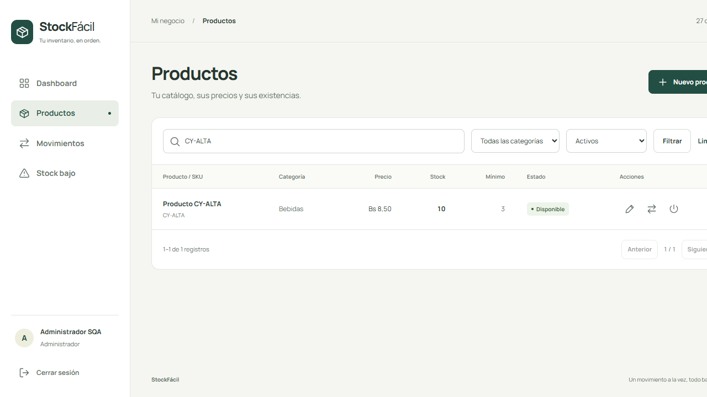
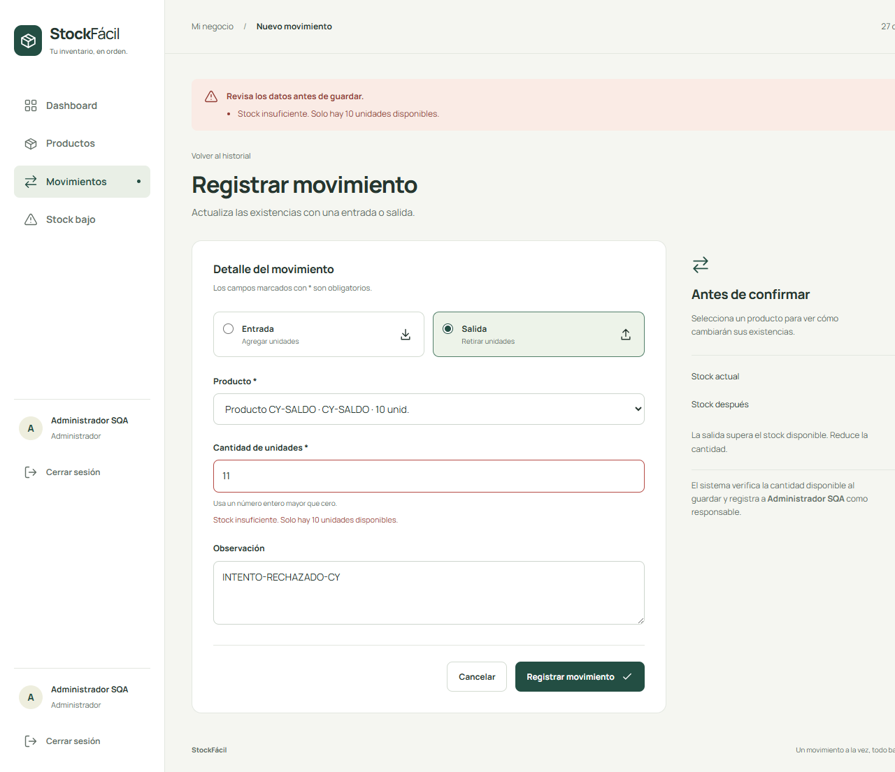
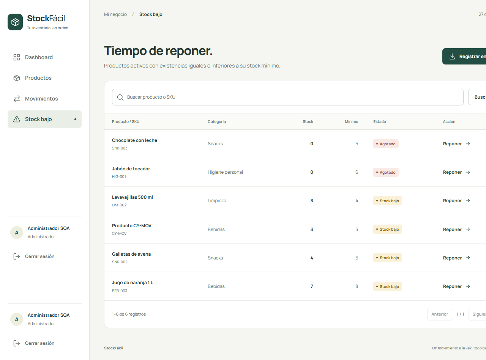

# Plan de pruebas de StockFácil

Universidad del Valle Univalle

Materia Software Quality Assurance

Docente Rolando Lara

Integrantes Andre Romero Caballero y Santiago Camacho Echalar

27 de octubre de 2026

## 1 Introducción

StockFácil es un sistema web para administrar el inventario de un pequeño negocio. Permite registrar productos, guardar sus precios, anotar entradas y salidas y consultar un historial de movimientos. También muestra alertas cuando las existencias llegan al mínimo establecido. Su propósito es que la persona encargada del negocio conozca qué tiene disponible y pueda reconocer cuándo necesita reponer un producto.

La calidad es importante porque las cantidades registradas se utilizan para tomar decisiones. Si una entrada no se suma correctamente, una salida se descuenta dos veces o se permite retirar más de lo disponible, el inventario deja de representar la situación del negocio. Por eso, el trabajo se concentró en comprobar las funciones que afectan el acceso y el manejo de existencias.

Este plan explica qué se revisó, cómo se organizaron las tareas, qué pruebas se ejecutaron y qué resultados se obtuvieron. Se basa en el proyecto que ya estaba desarrollado. Se conservaron sus funciones y se añadieron pruebas y documentos para comprobar su funcionamiento. Los resultados se presentan con ejemplos del propio sistema y con capturas reales donde ayudan a entender lo realizado.

El equipo está formado por dos integrantes. Se eligió Kanban para organizar el trabajo mediante estados sencillos y para que cada tarea pase por pruebas y revisión antes de considerarse terminada. La calidad se atiende durante el desarrollo, la corrección y el cierre de las tareas.

### Qué se busca con este plan

- Comprobar que solamente se ingrese al inventario después de iniciar sesión.
- Verificar que los productos se guarden con datos válidos y sin repetir su código.
- Revisar que las entradas y salidas cambien las cantidades correctamente.
- Evitar que una operación rechazada modifique el saldo o el historial.
- Mantener resultados comprobables y reconocer los trabajos que todavía requieren revisión del equipo.

### Qué cambió respecto al trabajo anterior

Ya existían casos de prueba, informes de SQA y actividades sobre registro de usuarios. Esos documentos se conservaron como antecedentes. No se encontró un Test Plan completo organizado con los ocho apartados de esta entrega. Por ese motivo, se preparó un plan que reúne el alcance, las herramientas, la organización del equipo y los resultados actuales.

Antes de incorporar las nuevas comprobaciones, la suite existente aprobó 60 pruebas. En esta entrega se añadieron pruebas de navegador con Selenium y Cypress y cuatro comprobaciones sobre el estado de las existencias. También se prepararon reglas de Kanban y la ejecución automática en GitHub. El cambio principal es que cada tarea se relaciona con una prueba y un resultado que se puede revisar.

## 2 Alcance

### Partes del sistema que se revisan

Se seleccionaron tres partes de StockFácil porque representan un recorrido habitual de uso: entrar al sistema, registrar un producto y actualizar sus existencias. La revisión incluye acciones correctas y situaciones que el sistema debe rechazar. No basta con comprobar que un formulario se abre; también se revisa qué sucede después de enviarlo.

| Parte del sistema | Qué se comprueba | Casos relacionados |
| --- | --- | --- |
| Inicio y cierre de sesión | Entrar con datos correctos, rechazar datos incorrectos y proteger las páginas privadas. | CP-01 y CP-02. |
| Registro de productos | Guardar un producto, registrar sus existencias iniciales y evitar códigos repetidos. | CP-03 y CP-04. |
| Movimientos y alertas | Sumar entradas, descontar salidas, rechazar cantidades inválidas y mostrar stock bajo. | CP-05 a CP-08. |

El SKU es el código que identifica a cada producto. Aunque dos productos puedan tener nombres parecidos, su código debe permitir distinguirlos. En las pruebas se utilizaron códigos de ejemplo, como CY-ALTA y CY-MOV, para reconocer los registros creados durante la ejecución.

### Historias de usuario y resultados esperados

**Registro de productos, HU-01.** Como administrador, se necesita guardar un producto para mantener actualizado el catálogo. Debe aparecer en el listado, conservar su precio y registrar las unidades iniciales. Si se intenta repetir su código, el sistema debe mostrar un error y evitar un segundo registro.

**Control de existencias, HU-02.** Como administrador, se necesita registrar lo que entra y sale del negocio. Una entrada aumenta las unidades; una salida las disminuye. Cada movimiento debe permitir revisar lo que ocurrió. Si la salida supera el saldo, la operación debe rechazarse sin dejar cambios parciales.

**Acceso al inventario, HU-03 en esta matriz.** Como usuario registrado, se necesita ingresar con credenciales válidas. Las páginas del inventario deben permanecer protegidas cuando no hay una sesión abierta. Cerrar sesión debe impedir volver a consultar esas páginas sin identificarse nuevamente.

### Reglas importantes del alcance

Una cantidad inicial positiva debe dejar un movimiento que explique de dónde salieron las primeras unidades. Las cantidades de los movimientos deben ser enteras y mayores que cero. El stock no debe quedar negativo. Además, la alerta debe aparecer cuando el saldo sea igual o inferior al mínimo, y no solamente cuando el producto se agote.

Estas reglas se comprobaron con datos pequeños para facilitar su revisión. Por ejemplo, pasar de 10 a 15 unidades después de una entrada de 5 permite entender el resultado sin realizar cálculos largos. También se utilizó una salida de 11 sobre un saldo de 10 para comprobar un rechazo claro.

### Qué queda fuera

La nueva matriz no incluye pruebas de carga con muchos usuarios, una revisión completa de seguridad ni una comprobación de todos los navegadores. Tampoco se agregaron funciones de facturación, compras o manejo de varios negocios. El registro de cuentas y otras funciones existentes permanecen en la suite general, pero no tienen un caso nuevo de aceptación para cada variante en este plan.

La revisión manual de las pantallas en computadora y celular está preparada, pero no se presenta como realizada. Este límite se mantiene visible para diferenciar los resultados automáticos de la valoración que todavía debe hacer una persona.

## 3 Estrategia de pruebas

### Cómo se hicieron las comprobaciones

Se utilizaron Selenium y Cypress, dos de las herramientas permitidas por el docente. Ambas trabajan sobre el sistema abierto en un navegador y permiten comprobar acciones parecidas a las que realiza una persona. También se aprovechó PHPUnit, que ya estaba en el proyecto, para revisar reglas y comprobar los datos que quedan guardados.

Se combinaron las herramientas porque muestran diferentes partes del resultado. Una captura permite observar el mensaje de error o el producto guardado. Las comprobaciones sobre los datos permiten confirmar, por ejemplo, que una salida rechazada no agregó un movimiento al historial. Las dos revisiones se complementan.

| Tipo de prueba | Cómo se aplicó en StockFácil |
| --- | --- |
| Unitaria | Se revisaron reglas pequeñas. Entre ellas, el estado del producto cuando tiene cero unidades, está bajo el mínimo, llega al mínimo o lo supera. |
| Funcional | Se realizaron acciones desde el navegador: entrar al sistema, guardar productos y registrar movimientos. |
| Integración | Se comprobó que formularios, reglas y datos guardados funcionaran en conjunto. |
| Aceptación | Los ocho casos expresan lo que se espera de las funciones principales. La aprobación final del equipo requiere una revisión humana adicional. |
| Regresión | Se repitieron pruebas después de hacer cambios para comprobar que lo que ya funcionaba siguiera funcionando. |
| Exploratoria | Se preparó un recorrido manual para valorar la navegación, los mensajes y el uso en diferentes tamaños de pantalla. Sigue pendiente. |

### Preparación del entorno y los datos

El proyecto mantiene sus tecnologías: Laravel, PHP, páginas Blade y una base SQLite. No fue necesario reconstruirlo ni cambiar su arquitectura para poder probarlo. Las pruebas de navegador preparan una base nueva, cargan datos de ejemplo y abren una instancia del sistema separada del uso habitual.

Esta separación permite repetir los escenarios sin borrar productos del negocio ni alterar sus movimientos. La cuenta de prueba sqa@example.test se utiliza para entrar a ese entorno. Sus datos son de demostración. Al terminar se cierra el servidor utilizado por las pruebas. También se comprobó que la configuración y la base habitual se conservaran.

### Casos de prueba principales

Los siguientes casos desarrollan los ocho puntos del alcance. Se indican las condiciones, los datos utilizados, las acciones realizadas y el resultado observado. Todos los estados corresponden a la última ejecución comprobada. Los intentos anteriores que fallaron se explican en los resultados, para conservar lo que realmente ocurrió.

### CP-01 Iniciar y cerrar sesión

**Objetivo y requisito:** comprobar el acceso de un usuario registrado y el cierre de la sesión, relacionado con HU-03. **Prioridad:** crítica.

**Antes de probar:** el sistema de prueba debe estar disponible y la sesión debe estar cerrada. Se utiliza la cuenta sqa@example.test con su contraseña de demostración válida.

**Pasos:** abrir el inicio de sesión, escribir los datos, ingresar y comprobar que aparece el panel principal. Después, cerrar sesión e intentar abrir el listado de productos.

**Esperado:** los datos correctos permiten entrar. Después de cerrar sesión, el sistema solicita identificarse nuevamente. **Obtenido:** Selenium comprobó el ingreso, el panel principal y el regreso al inicio de sesión al intentar entrar al catálogo. **Estado:** aprobado. **Evidencia:** registro de resultados de Selenium y captura del panel principal.

### CP-02 Rechazar el acceso no autorizado

**Objetivo y requisito:** comprobar que no se puede consultar el inventario sin una sesión válida, relacionado con HU-03. **Prioridad:** crítica.

**Antes de probar:** existe una cuenta, pero no hay una sesión abierta. Se utiliza el correo de prueba y una contraseña incorrecta.

**Pasos:** intentar abrir directamente el panel del inventario sin iniciar sesión. Después, completar el formulario con la contraseña incorrecta y enviarlo.

**Esperado:** la página privada lleva al inicio de sesión y los datos incorrectos muestran un error. **Obtenido:** se mostró el mensaje de credenciales incorrectas y no se abrió una sesión. Las pruebas generales también comprobaron la protección de las páginas internas. **Estado:** aprobado. **Evidencia:** resultados de Selenium, captura del acceso rechazado y reporte de PHPUnit.

### CP-03 Guardar un producto con existencias iniciales

**Objetivo y requisito:** comprobar un registro válido de producto y sus primeras unidades, relacionado con HU-01. **Prioridad:** crítica.

**Antes de probar:** el usuario está identificado, existe la categoría Bebidas y el código CY-ALTA todavía no se ha utilizado.

**Datos:** nombre Producto CY-ALTA, precio de Bs 8,50, stock inicial de 10 unidades y mínimo de 3. **Pasos:** completar el formulario, guardar el producto y buscarlo por su código en el listado.

**Esperado:** aparece un producto con 10 unidades y una entrada inicial que explica ese saldo. **Obtenido:** Cypress comprobó el producto en pantalla y PHPUnit comprobó las unidades, el precio y el movimiento inicial, de 0 a 10, con su responsable. **Estado:** aprobado. **Evidencia:** captura del producto registrado y reporte de PHPUnit.

### CP-04 Evitar un código de producto repetido

**Objetivo y requisito:** comprobar que el código de un producto sea único, relacionado con HU-01. **Prioridad:** alta.

**Antes de probar:** el producto CY-ALTA ya fue guardado y el usuario continúa identificado. Se prepara otro producto con el código cy-alta, escrito en minúsculas.

**Pasos:** completar el segundo formulario, enviarlo, revisar el mensaje del código y volver a buscar el producto original.

**Esperado:** se rechaza el código repetido y se conserva un solo producto. **Obtenido:** Cypress observó el error y una sola fila en la búsqueda. PHPUnit también comprobó que no se creó un segundo registro. **Estado:** aprobado. **Evidencia:** captura del error de código repetido y reporte de pruebas. La diferencia entre mayúsculas y minúsculas no permitió duplicar el producto.

### CP-05 Registrar una entrada de unidades

**Objetivo y requisito:** comprobar que una entrada aumente el saldo y quede registrada, relacionado con HU-02. **Prioridad:** crítica.

**Antes de probar:** el producto CY-MOV tiene 10 unidades y el administrador ha iniciado sesión. **Datos:** entrada de 5 unidades y observación ENTRADA-CY-5.

**Pasos:** abrir el registro de movimientos, seleccionar el producto, elegir Entrada, escribir la cantidad y guardar. Después, revisar el historial.

**Esperado:** el saldo cambia de 10 a 15 y aparece la entrada correspondiente. **Obtenido:** Cypress comprobó la fila del historial y el saldo de 15. PHPUnit verificó la cantidad, los saldos anterior y final y el usuario responsable. **Estado:** aprobado. **Evidencia:** captura de la entrada y reporte de pruebas.

### CP-06 Rechazar una salida mayor al saldo

**Objetivo y requisito:** impedir que las existencias queden negativas, relacionado con HU-02. **Prioridad:** crítica.

**Antes de probar:** el producto CY-SALDO tiene 10 unidades y un movimiento inicial. **Datos:** salida de 11 unidades y una observación que permite reconocer el intento.

**Pasos:** seleccionar el producto, elegir Salida, escribir 11 y enviar. Revisar el error, volver al catálogo y consultar el historial de ese producto.

**Esperado:** se rechaza la salida y se mantienen las 10 unidades y el movimiento inicial. **Obtenido:** se mostró stock insuficiente; Cypress comprobó el saldo de 10 y la ausencia de un movimiento por el intento rechazado. PHPUnit comprobó lo mismo sobre los datos. **Estado:** aprobado. **Evidencia:** captura del mensaje y reportes de ambas herramientas.

### CP-07 Mostrar la alerta al llegar al mínimo

**Objetivo y requisito:** comprobar la salida válida y la alerta de reposición, relacionado con HU-02. **Prioridad:** alta.

**Antes de probar:** después de CP-05, el producto CY-MOV tiene 15 unidades y su mínimo es 3. **Datos:** salida de 12 unidades, con la observación SALIDA-CY-12.

**Pasos:** registrar la salida, revisar el saldo final y abrir la pantalla de productos con stock bajo.

**Esperado:** quedan 3 unidades y aparece la alerta, porque el saldo es igual al mínimo. **Obtenido:** Cypress comprobó los saldos 15 y 3 en el historial y la alerta Stock bajo. Las pruebas de PHPUnit también verificaron el límite exacto. **Estado:** aprobado. **Evidencia:** captura de la alerta y reporte de pruebas.

### CP-08 Rechazar cantidades inválidas

**Objetivo y requisito:** comprobar que los movimientos acepten solamente cantidades enteras y positivas, relacionado con HU-02. **Prioridad:** crítica.

**Antes de probar:** la prueba prepara un producto con 10 unidades y su entrada inicial. Cada variante utiliza su propia preparación para no afectar a la siguiente.

**Datos y pasos:** enviar un movimiento con 0, -1, 1,5, texto sin valor numérico o un campo sin valor. Comprobar el error y revisar el saldo y la cantidad de movimientos.

**Esperado:** se rechaza cada valor y se mantienen las 10 unidades y un solo movimiento inicial. **Obtenido:** PHPUnit comprobó las variantes y confirmó que no cambiaron las existencias ni el historial. **Estado:** aprobado. **Evidencia:** reporte de PHPUnit con los resultados de las cantidades inválidas.

### Ejemplos de Dado Cuando Entonces

Se utilizaron escenarios BDD para expresar el comportamiento esperado con una situación inicial, una acción y su consecuencia. Esto ayuda a entender los casos antes de revisar las herramientas.

**Acceso, CP-01 y CP-02.** Dado un usuario registrado y una página privada, cuando ingresa datos correctos puede consultar el inventario. Entonces, al cerrar sesión, debe volver a identificarse para entrar al catálogo.

**Productos, CP-03 y CP-04.** Dado un producto con un código ya guardado, cuando se intenta registrar otro producto con ese código, incluso en minúsculas, entonces se muestra un error y permanece un solo registro.

**Movimientos, CP-05 a CP-07.** Dado un producto con 10 unidades y mínimo de 3, cuando se agregan 5 y se retiran 12, entonces quedan 3 y aparece stock bajo. Si se intenta retirar más de lo disponible, la salida debe rechazarse sin modificar el inventario.

Los escenarios se relacionaron con pruebas ejecutables del proyecto. No se declara que se aplicó TDD en esta entrega, porque las pruebas se añadieron sobre un sistema que ya existía. Se conserva la diferencia entre describir un comportamiento esperado y afirmar que hubo un proceso de desarrollo que no se realizó.

### Revisión manual preparada

La automatización comprueba cantidades, mensajes y cambios de pantalla, pero también hace falta recorrer el sistema para valorar si resulta claro. Se preparó MAN-01 para revisar la navegación en computadora y celular, el foco al usar Tab, los campos obligatorios, los mensajes y el recorrido de producto y movimiento.

La persona que lo ejecute debe registrar fecha, navegador, tamaño de pantalla, acciones realizadas, observaciones y alguna captura propia si aparece un problema. No basta con escribir que todo funcionó. Debe indicar qué recorrió y qué resultado observó. Esta actividad sigue sin ejecución humana registrada y se cuenta como pendiente.

## 4 Roles y responsabilidades

La calidad es una responsabilidad compartida. Ninguno de los integrantes se limita solamente a desarrollar o solamente a probar. Los dos pueden trabajar en funciones, ejecutar comprobaciones y corregir problemas. El reparto propuesto sirve para evitar tareas sin responsable y para que una persona no revise únicamente su propio trabajo.

| Integrante | Responsabilidades principales | Revisión del compañero |
| --- | --- | --- |
| Andre Romero Caballero | Trabajar en productos, actualizar el plan, revisar las métricas y mantener la relación entre tareas y resultados. | Revisar los cambios y las pruebas de Santiago. |
| Santiago Camacho Echalar | Trabajar en movimientos, preparar casos de prueba, ejecutar comprobaciones y registrar problemas encontrados. | Revisar los cambios y la documentación de Andre. |
| Ambos integrantes | Definir los resultados esperados, cuidar los datos de prueba, corregir errores y preparar la entrega. | Confirmar los pendientes antes del cierre. |

Cuando uno termina una tarea, el otro debe revisar qué se cambió, qué caso se ejecutó y qué resultado se guardó. Si no entiende cómo repetir la prueba, la tarea necesita una explicación adicional. Si encuentra una diferencia entre lo esperado y lo observado, se registra y se devuelve a corrección.

Los nombres de la tabla representan responsabilidades propuestas. No demuestran por sí solos que una persona haya desarrollado o aprobado una tarea. Los cambios de esta ejecución se registraron con la identidad Git configurada de AndreRCRO. La participación de Santiago y la revisión cruzada deben quedar registradas cuando se realicen desde su propia cuenta.

El docente Rolando Lara evalúa la entrega académica. Las pruebas aprobadas y la revisión técnica no se presentan como una aprobación anticipada del docente. El equipo debe poder mostrar el proyecto, explicar los resultados y señalar con claridad lo que falta completar.

## 5 Ciclo de vida de las pruebas

### Organización del trabajo con Kanban

Se eligió Kanban porque el equipo es pequeño y necesita controlar el desarrollo, las pruebas y las correcciones sin organizar reuniones o roles innecesarios. Cada tarjeta representa un trabajo concreto. Por ejemplo, comprobar una salida con stock insuficiente es una tarea con un resultado que se puede observar y revisar.

El flujo utiliza cinco estados. Una tarea puede volver a un estado anterior si aparece un problema; no tiene que avanzar a Terminado solamente porque ya pasó por desarrollo.

| Estado | Qué significa y cuándo se puede avanzar |
| --- | --- |
| Pendiente | La tarea está identificada. Debe tener un responsable, prioridad y resultado esperado antes de empezar. |
| En desarrollo | Se modifica o prepara lo necesario. Puede pasar a pruebas cuando existe una versión que se puede ejecutar. |
| En pruebas | Se ejecutan los casos y se guardan resultados. Si falla, pasa a corrección. Si aprueba, espera la revisión del compañero. |
| En corrección | Se revisa el problema y se aplica una solución. Después vuelve a pruebas para comprobar que la corrección funciona. |
| Terminado | Las pruebas aprobaron, la evidencia está disponible, la documentación se actualizó y el compañero revisó el trabajo. |

El límite es de **dos tareas al mismo tiempo en desarrollo** para todo el equipo. Antes de comenzar una tercera, se debe terminar o desbloquear alguna de las anteriores. Este límite ayuda a que las pruebas y los documentos no queden para el último momento.

### Prioridades y seguimiento

Se atienden primero los problemas que impiden entrar al sistema o afectan las cantidades del inventario. Después se revisan las validaciones, los mensajes, las herramientas y la documentación. Los ajustes visuales que no impiden el uso tienen menor prioridad que un saldo incorrecto o una prueba que no se puede repetir.

El tablero se revisa al iniciar y cerrar cada bloque de trabajo. Se comprueba qué se está haciendo, qué quedó bloqueado, qué falló y qué necesita revisión. No se requieren sprints ni reuniones de Scrum para aplicar este flujo. Lo importante es que el estado de cada tarea represente su situación real.

Se prepararon las siguientes tareas para relacionar el trabajo con las pruebas y los documentos. Los responsables son los del reparto propuesto. Las tareas que aprobaron la parte técnica siguen en pruebas mientras no se acredite la revisión humana correspondiente.

| Tarea | Responsable propuesto | Situación registrada |
| --- | --- | --- |
| K-01 Revisar la consigna y el alcance. | Andre. | En pruebas. |
| K-02 Comprobar acceso y cierre de sesión. | Santiago. | En pruebas. |
| K-03 Comprobar registro de productos y códigos. | Andre. | En pruebas. |
| K-04 Comprobar movimientos y alertas. | Santiago. | En pruebas. |
| K-05 Ejecutar Selenium y Cypress. | Santiago. | En pruebas. |
| K-06 Corregir los problemas de automatización. | Santiago. | En pruebas. |
| K-07 Completar el plan y su versión Word. | Andre. | En pruebas. |
| K-08 Revisar calidad y calcular resultados. | Andre. | En pruebas. |
| K-09 Comprobar las pruebas automáticas de GitHub. | Santiago. | En pruebas. |
| K-10 Publicar tablero y registrar la revisión del cambio. | Ambos. | Pendiente de acreditación. |
| K-11 Ejecutar el recorrido manual. | Santiago, con revisión de Andre. | Pendiente. |

### Qué ocurre cuando falla una prueba

Primero se anota qué se intentó hacer, con qué datos y qué diferencia apareció. Después se busca la causa y se corrige. Al volver a ejecutar se guarda el nuevo resultado y se conserva el anterior. Así se puede explicar el problema y la mejora realizada, en lugar de mostrar solamente una captura final.

Si el fallo está en el propio caso de prueba, también se registra. En esta entrega ocurrió con la selección de un botón y con la búsqueda de un producto en un listado paginado. Corregir la prueba no significa que se haya corregido un error del inventario; esa diferencia se mantiene en los resultados.

### Uso de GitHub en el proceso

El repositorio permite guardar cambios reales y consultar su historial. La rama main se utiliza como base y la rama test/sqa-kanban contiene el trabajo de esta entrega para revisión. Se preparó la descripción del cambio propuesto para abrir un Pull Request, que es la solicitud para revisar e integrar esos cambios.

También se prepararon once Issues con descripción, responsable propuesto, prioridad y aceptación. Se mantiene como pendiente acreditar su publicación, el tablero con los cinco estados y la revisión cruzada. Tener un archivo preparado no se presenta como si el tablero ya estuviera funcionando en GitHub.

## 6 Criterios de entrada y salida

### Cuándo una tarea está lista para empezar

La **Definition of Ready** indica que el trabajo está suficientemente claro para comenzar. En StockFácil significa que se conoce la función que se quiere revisar, se asignó un responsable, se definió el resultado esperado y están disponibles los datos necesarios. Si falta alguna de estas condiciones, la tarea permanece pendiente o se aclara antes de cambiar código.

Por ejemplo, una tarea que solamente dice revisar movimientos todavía es amplia. Una tarea que indica comprobar que se rechaza una salida de 11 cuando hay 10 unidades ya tiene una situación y un resultado verificables. Esto reduce las interpretaciones distintas entre los integrantes.

### Condiciones para ejecutar las pruebas

Antes de probar se debe comprobar que el sistema pueda abrirse, que las herramientas estén disponibles y que se utilicen datos separados del inventario habitual. También se debe conocer cuál es la versión que se está revisando. Si el entorno no inicia, se registra el motivo sin afirmar que la función pasó o falló.

El caso debe indicar lo que se espera y cómo se observará el resultado. En un registro de producto se revisa el listado y el movimiento inicial. En una salida rechazada se revisan el error, el saldo y el historial. La comprobación debe cubrir el efecto de la acción, no solamente el mensaje de confirmación.

### Cuándo se puede terminar una tarea

La **Definition of Done** exige que el trabajo cumpla lo acordado y esté listo para que otro integrante lo revise o lo utilice. Se consideran estas condiciones:

- La función o comprobación cumple el resultado esperado.
- Los casos correspondientes y las pruebas relacionadas aprobaron.
- Los problemas encontrados se corrigieron o quedaron identificados como pendientes aceptados.
- El resultado y la evidencia se guardaron y la documentación coincide con ellos.
- El cambio quedó registrado en Git y el compañero realizó su revisión.

Una tarea no pasa a Terminado solamente porque el código fue escrito o porque una prueba aislada aprobó. Si falta la revisión humana, permanece en pruebas. Los problemas abiertos que afectan acceso o integridad del inventario impiden aceptar esa función.

## 7 Métricas y control de calidad

### Resultados obtenidos

Las herramientas dejaron los siguientes resultados finales. Son comprobaciones ejecutadas, no una estimación de lo que podría funcionar.

| Herramienta | Comprobaciones ejecutadas | Aprobadas | Fallidas al finalizar |
| --- | --- | --- | --- |
| PHPUnit | 64 | 64 | 0 |
| Selenium | 2 | 2 | 0 |
| Cypress | 3 | 3 | 0 |
| Total | 69 | 69 | 0 |

PHPUnit ejecutó 7 pruebas unitarias y 57 pruebas que revisan funciones y su relación con los datos. En conjunto realizó 423 verificaciones internas, llamadas aserciones. La ejecución inicial tenía 60 pruebas y 419 aserciones; las cuatro comprobaciones añadidas revisan el estado de las existencias cuando un producto está agotado, bajo el mínimo, justo en el mínimo o por encima.

Selenium comprobó el acceso, el rechazo de credenciales incorrectas y el cierre de sesión. Cypress agrupó sus comprobaciones en tres escenarios: producto y código repetido, rechazo de una salida excesiva y movimientos con alerta. Un escenario puede contener varias comprobaciones, por eso las cifras de herramientas y de casos del plan se presentan por separado.

### Cómo se interpretan los indicadores

| Indicador del plan | Resultado | Cómo se obtiene |
| --- | --- | --- |
| Casos principales previstos. | 8. | CP-01 a CP-08. |
| Casos principales ejecutados y aprobados. | 8. | Resultados finales de los ocho casos. |
| Recorrido manual previsto. | 1. | MAN-01, todavía sin ejecución humana registrada. |
| Total de actividades de prueba previstas. | 9. | Ocho casos automáticos y un recorrido manual. |
| Actividades completadas por ejecución. | 8 de 9, 88,89%. | 8 dividido entre 9, multiplicado por 100. |
| Aprobación de los casos ejecutados. | 100%. | 8 aprobados dividido entre 8 ejecutados. |
| Partes del alcance con pruebas. | 3 de 3. | Acceso, productos y movimientos con alertas. |
| Problemas nuevos confirmados de la aplicación. | 0 en esta revisión. | No se identificó un fallo nuevo de producto en los resultados. |
| Problemas de automatización corregidos. | 2 de 2. | Selección del botón y búsqueda en el listado. |

El 100% se refiere a los casos ejecutados. No significa que se hayan revisado todas las posibilidades del sistema ni que la entrega ya tenga aceptación humana. La cobertura de tres partes indica que cada área del alcance tiene pruebas; no mide todas las líneas del código.

No se calculó una densidad de defectos porque no se definió una medida del tamaño del sistema para compararla. Tampoco se calculó velocidad de trabajo del equipo, ya que no hay varios períodos con tareas cerradas por ambos integrantes. Es preferible explicar estos límites que mostrar un número sin base.

### Evidencias de los resultados

Las siguientes capturas se guardaron durante las pruebas del 27 de octubre. Se muestran las partes relevantes de las pantallas para que el dato comprobado se pueda leer. Los archivos originales de las capturas se conservan en el proyecto.

Al guardar el producto CY-ALTA, el listado mostró el registro con un precio de Bs 8,50 y **10 unidades**. La búsqueda por código permitió localizarlo sin depender de la página del catálogo en la que quedara ubicado.

El caso de stock insuficiente utilizó el producto CY-SALDO. El usuario intentó retirar **11 unidades cuando solamente había 10**. La pantalla mostró el error y conservó los datos ingresados para poder corregirlos. La prueba también revisó que el saldo siguiera en 10 y que el historial no incorporara el intento rechazado.

En la salida válida del producto CY-MOV, el saldo pasó de 15 a **3 unidades**. Como su mínimo era 3, apareció con el estado **Stock bajo**. La captura permite comparar el saldo con el mínimo y observar el resultado del límite exacto.

### Problemas encontrados y correcciones

La primera ejecución de Cypress no aprobó los tres escenarios. La prueba buscaba cualquier botón de envío y encontraba más de uno, porque la pantalla también tenía el botón para cerrar sesión. Se ajustó la selección para actuar solamente sobre el formulario que se estaba probando.

Después de esa corrección aprobaron dos escenarios. El caso del producto todavía fallaba porque buscaba el registro nuevo en la primera página de un catálogo dividido en varias páginas. El producto sí se había guardado, pero no estaba en la página que la prueba estaba observando. Se cambió la comprobación para buscarlo por su código.

| Ejecución de Cypress | Resultado | Qué se hizo después |
| --- | --- | --- |
| Primera. | 0 aprobados y 3 fallidos. | Se limitó la selección del botón al formulario correcto. |
| Segunda. | 2 aprobados y 1 fallido. | Se añadió la búsqueda del producto por código. |
| Final. | 3 aprobados y 0 fallidos. | Se conservaron los resultados y las capturas de la ejecución. |

Los dos problemas correspondían a las pruebas automáticas. No se presentan como defectos corregidos de la lógica del inventario. Se conservaron las ejecuciones anteriores para poder mostrar la causa, el cambio y el resultado posterior.

### Revisión de calidad realizada

La revisión técnica del 27 de octubre tuvo como objetivo comprobar que el plan correspondiera al proyecto y que los resultados pudieran verificarse. Se revisaron las reglas de productos y movimientos, las páginas protegidas, los casos preparados, los reportes de las herramientas, los archivos de Git y los documentos de la entrega.

Se comprobó que las pruebas utilizaran datos separados, que las cantidades esperadas coincidieran con las operaciones y que los mensajes observados correspondieran al caso. También se comparó la integridad de la configuración y de la base habitual antes y después de las pruebas: ambas se conservaron. La revisión de archivos publicables no detectó los patrones de secretos buscados; ese control limitado no equivale a una auditoría completa de seguridad.

Como seguimiento, se mantienen pendientes la revisión real del compañero, la acreditación del tablero y de los Issues y la ejecución manual. Estas observaciones no se eliminan porque las herramientas hayan aprobado. El informe de auditoría del proyecto conserva el detalle de lo revisado y las acciones pendientes.

### Pruebas automáticas en GitHub

Los cambios están guardados en el [repositorio de StockFácil](https://github.com/AndreRCRO/StockFacil/tree/test/sqa-kanban). Se configuró GitHub Actions para instalar lo necesario y ejecutar las pruebas cuando se suben cambios o se abre una solicitud de revisión. Esto ayuda a detectar si una modificación posterior afecta una función que ya había aprobado.

La [ejecución comprobada en GitHub](https://github.com/AndreRCRO/StockFacil/actions/runs/40573878583) terminó correctamente e incluyó PHPUnit, Selenium y Cypress. GitHub también conservó un paquete con los resultados. Así existe evidencia tanto de las ejecuciones locales como de una ejecución remota, sin presentar una configuración preparada como si fuera una prueba ya realizada.

Si otro integrante quiere repetir las pruebas, debe instalar las dependencias del proyecto y seguir los comandos del README. Los comandos principales son `php vendor/phpunit/phpunit/phpunit --colors=never`, `npm run test:selenium` y `npm run test:cypress`. Las pruebas de navegador preparan su base de ejemplo; no deben reemplazarse por ejecuciones sobre el inventario real.

## 8 Riesgos y mitigación

Los riesgos se revisan para decidir en qué conviene concentrar el tiempo. La probabilidad expresa qué tan posible es que ocurra el problema; el impacto indica cuánto afectaría el trabajo o los datos. Son valoraciones del plan, no porcentajes obtenidos de las pruebas.

| Riesgo | Probabilidad e impacto | Qué se hace para reducirlo |
| --- | --- | --- |
| Poco tiempo antes de la entrega. | Alta y alto. | Priorizar los ocho casos principales y mantener el límite de dos tareas en desarrollo. |
| Modificar el inventario habitual al probar. | Media y alto. | Utilizar una base separada y comprobar que los datos habituales se conservan. |
| Dificultades al instalar las herramientas o sus navegadores. | Media y medio. | Preparar la instalación con anticipación y conservar las instrucciones de ejecución. |
| Diferencias entre la computadora local y GitHub. | Media y medio. | Comprobar la ejecución remota y revisar su resultado antes de darla por aprobada. |
| Que una prueba automática no detecte una dificultad de uso. | Media y medio. | Completar el recorrido manual en computadora, celular y con teclado. |
| Entregar sin tablero o sin revisión del compañero. | Alta y alto. | Mantener los pendientes visibles y registrar la participación real de ambos integrantes. |

Un riesgo no se considera resuelto solamente porque se escribió una medida en esta tabla. Por ejemplo, la revisión manual continuará pendiente hasta que una persona la ejecute y registre lo observado. De la misma manera, el tablero debe poder abrirse y mostrar sus tareas reales, y la revisión del cambio debe tener un registro del compañero.

### Qué falta para cerrar la entrega

- Publicar o acreditar los Issues y el tablero con los cinco estados de Kanban, relacionando las tareas con sus casos y resultados.
- Abrir la solicitud de revisión del cambio y registrar los comentarios reales de Santiago y las respuestas o correcciones correspondientes.
- Ejecutar MAN-01 en computadora y celular, guardar la fecha y el resultado, y añadir una captura si ayuda a explicar una observación.
- Actualizar los estados y las métricas después de esas actividades, sin conservar como pendiente algo que ya se comprobó ni declarar terminado lo que no se realizó.

Como mejora posterior se puede ampliar la revisión de navegadores y de situaciones menos frecuentes. Para esta entrega se prioriza explicar y defender las funciones existentes con resultados reales. No se incorporan funciones adicionales solamente para aumentar el tamaño del proyecto.

El plan se actualiza cuando cambia una tarea o se repite una prueba. Se conservan los resultados anteriores para explicar qué cambió y qué sigue pendiente.
