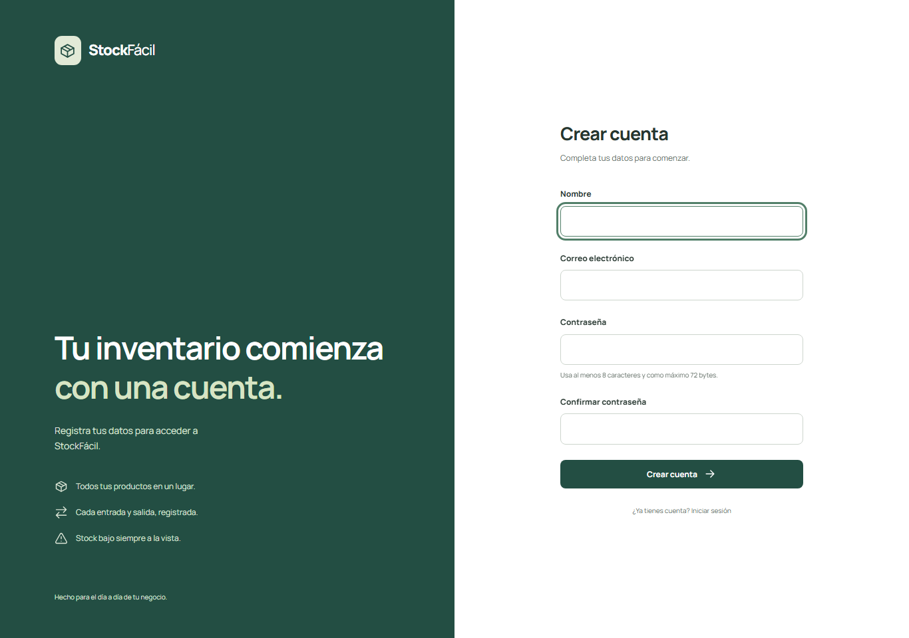
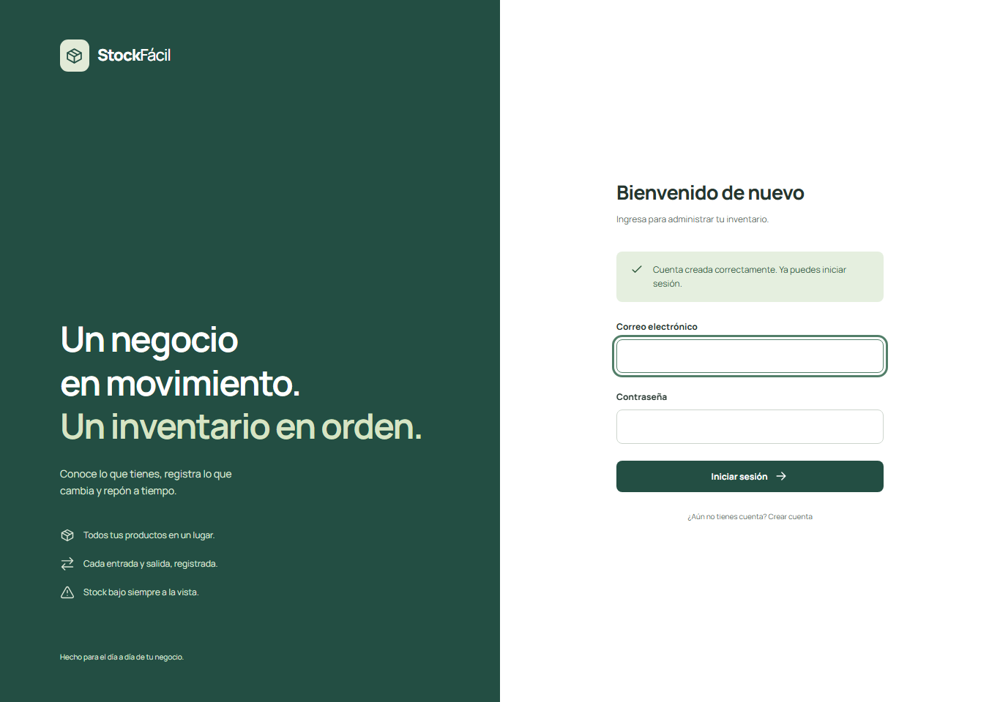
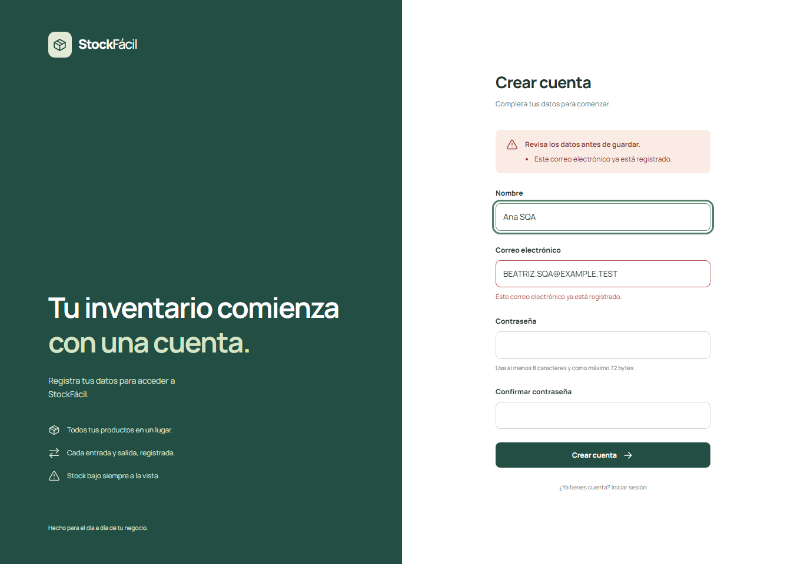
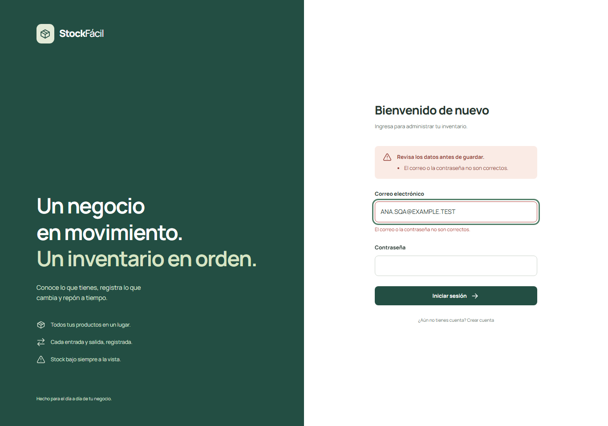
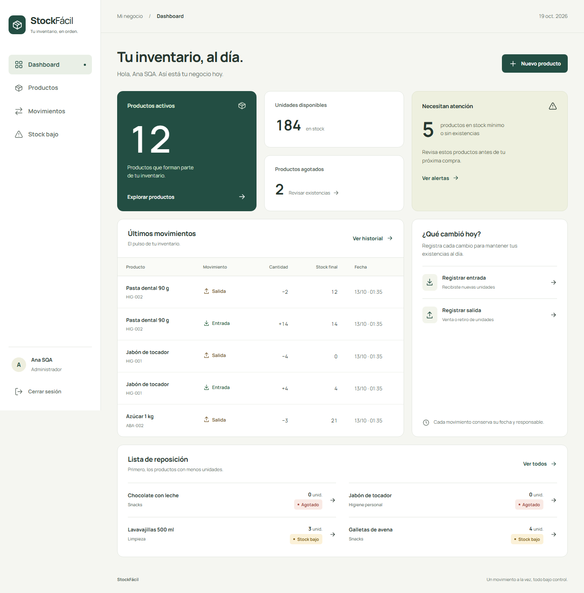

# Del comportamiento a la implementación

## Registro de usuarios en StockFácil

Universidad Privada del Valle

Facultad de Informática y Electrónica

Carrera de Ingeniería de Sistemas Informáticos

Elaborado por: Andre Romero Caballero y Santiago Camacho

Tercer integrante: [Pendiente de confirmar]

Asignatura: Software Quality Assurance

Docente: Rolando Lara

Gestión académica: 2/2026

Santa Cruz, Bolivia

Fecha de revisión: 19 de octubre de 2026

### Presentación

Se revisó el registro de usuarios del proyecto StockFácil y se corrigieron las diferencias entre el código, las pruebas y el informe anterior. El registro completo ya funcionaba al empezar esta revisión. Las pruebas nuevas encontraron problemas al utilizar directamente el servicio de creación de cuentas y al comparar un correo con datos que ya estaban guardados de otra manera.

El trabajo sigue las cuatro fases de la consigna. ATDD define los resultados que se esperan; BDD los describe mediante ejemplos; TDD permite comprobar una corrección desde una prueba que falla; y DDD ordena los datos y reglas del usuario.

La guía pide tres integrantes y que cada uno explique ATDD, BDD y TDD. Se conservan los dos nombres de la portada entregada. Falta confirmar el tercer integrante y quién asumirá el rol cliente para revisar los criterios.

---page---

## Fase 1 ATDD Criterios de aceptación

Como nuevo usuario de StockFácil, quiero crear una cuenta con mi nombre, correo y contraseña para poder ingresar al sistema.

### Primer criterio Registro exitoso

El sistema debe aceptar un nombre, un correo válido que no esté ocupado y una contraseña de al menos ocho caracteres con su confirmación. Debe crear exactamente una cuenta, guardar la contraseña protegida y permitir iniciar sesión con esos datos.

La cuenta no inicia sesión automáticamente. Después del registro aparece “Cuenta creada correctamente. Ya puedes iniciar sesión.” y se abre la pantalla de acceso.

### Segundo criterio Correo duplicado

No deben existir dos cuentas creadas por el registro con el mismo correo. La comparación debe considerar las mayúsculas, minúsculas y los espacios exteriores. Si el correo ya existe, debe mostrarse un aviso y conservarse la cuenta anterior.

Los dos criterios tienen respaldo en las pruebas ejecutadas. Su aprobación por el rol cliente sigue pendiente: [Integrante responsable, fecha y observaciones].



Figura 1. Formulario comprobado en la copia de pruebas. Se mantuvo el diseño existente.

---page---

## Fase 2 BDD Escenarios de uso

Se escribió un escenario por criterio, como pide la fase BDD de la guía. El primer ejemplo indica expresamente el ingreso del correo y la protección de la contraseña.

### Escenario 1 Crear una cuenta

```gherkin
Funcionalidad: Registro de usuario
Escenario: Crear una cuenta con datos válidos
  Dado que no existe una cuenta con el correo "ana@example.test"
  Y que ingreso el nombre "Ana SQA"
  Y que ingreso el correo "ana@example.test"
  Y que ingreso una contraseña válida y su confirmación
  Cuando confirmo el registro
  Entonces el sistema crea una sola cuenta
  Y almacena la contraseña de forma protegida
  Y muestra un mensaje de registro exitoso
  Y puedo iniciar sesión con esa cuenta
```

Se completó el formulario con datos válidos. La aplicación mostró el mensaje esperado y después permitió ingresar. La prueba HTTP comprobó además que hubiera un solo usuario y que la contraseña guardada fuera un hash válido.



Figura 2. Confirmación obtenida al repetir el registro en el sistema corregido.

---page---

### Escenario 2 Evitar un correo repetido

```gherkin
Escenario: Intentar registrar un correo ya utilizado
  Dado que existe una cuenta con el correo "ana@example.test"
  Cuando intento crear otra con " ANA@EXAMPLE.TEST "
  Y los demás datos son válidos
  Entonces aparece un aviso de correo ya registrado
  Y no se crea una segunda cuenta
  Y la cuenta anterior conserva sus datos
```

Se intentó repetir el correo cambiando las mayúsculas y agregando espacios. El sistema rechazó la solicitud. También se comprobó un caso adicional: que el correo existente ya estuviera guardado con esos espacios y mayúsculas. Ese caso fallaba al iniciar la revisión y quedó cubierto por la corrección.



Figura 3. El aviso permite corregir el correo y las contraseñas quedan vacías.

Los escenarios están en registro-usuario.feature. Se verifican mediante pruebas HTTP de PHPUnit y casos funcionales en Chromium. El archivo Gherkin describe el comportamiento; no se utilizó un ejecutor adicional como Cucumber.

---page---

## Fase 3 TDD Prueba del registro completo

La prueba de RegistrationData del informe anterior solo comprobaba los datos de un objeto. Se conserva como prueba auxiliar. Para comprobar el registro se utiliza ahora una prueba que pasa por la aplicación, guarda el usuario y verifica su acceso:

```php
public function test_registration_contract_creates_one_account_and_allows_authentication(): void
{
    $this->assertDatabaseCount('users', 0);
    $this->post('/register', [
        'name' => 'Ana SQA',
        'email' => ' ANA@EXAMPLE.TEST ',
        'password' => 'abc12345',
        'password_confirmation' => 'abc12345',
    ])->assertRedirect('/login')->assertSessionHas('status', 'Cuenta creada correctamente. Ya puedes iniciar sesión.');
    $this->assertDatabaseCount('users', 1);
    $user = User::firstOrFail();
    $this->assertSame('Ana SQA', $user->name);
    $this->assertSame('ana@example.test', $user->email);
    $this->assertNotSame('abc12345', $user->password);
    $this->assertTrue(Hash::check('abc12345', $user->password));
    $this->assertGuest();
    $this->post('/login', ['email' => ' ANA@EXAMPLE.TEST ', 'password' => 'abc12345'])->assertRedirect('/dashboard');
    $this->assertAuthenticatedAs($user);
    $this->get('/dashboard')->assertOk();
}
```

Esta prueba aprobó desde su primera ejecución. Se registra como una regresión de una funcionalidad existente y no como un RED nuevo. Antes de cambiar código, la suite del proyecto aprobó 52 pruebas con 378 aserciones.

Es una prueba de integración HTTP con SQLite en memoria. Las pruebas unitarias puras comprueban la normalización de los datos; por sí solas no demuestran que se haya creado una cuenta.

---page---

### RED Problemas que sí se observaron

Se revisó el servicio que crea las cuentas cuando se utiliza directamente, sin pasar por el formulario. Se encontró que aceptaba una contraseña de siete caracteres y un nombre vacío. Además, el registro permitía repetir un correo si el anterior ya estaba guardado con espacios o mayúsculas.

La siguiente prueba se escribió antes de corregir ese comportamiento:

```php
public function test_registration_service_rejects_short_password_without_creating_user(): void
{
    try {
        app(RegisterUser::class)->register(new RegistrationData('Ana SQA', 'ana@example.test', '1234567'));
        $this->fail('El servicio creó una cuenta con una contraseña de siete caracteres.');
    } catch (ValidationException $exception) {
        $this->assertArrayHasKey('password', $exception->errors());
    }
    $this->assertDatabaseCount('users', 0);
}
```

En la primera ejecución el servicio creó la cuenta y la prueba falló con el mensaje “El servicio creó una cuenta con una contraseña de siete caracteres.” Todo ocurrió en la base de pruebas.

Se ejecutaron cuatro pruebas nuevas: el registro completo aprobó y las otras tres fallaron. El resultado fue 4 pruebas, 20 aserciones y 3 fallos. No se quitó una función ni se introdujo un error para provocar ese resultado.

El comando utilizado fue:

```text
php vendor/phpunit/phpunit/phpunit --colors=never
  --do-not-cache-result --filter RegistrationWorkflowTest
```

La salida original se conserva en correccion/evidencias/01-red.txt y el detalle por prueba en 01-red.xml. El comando completo con la ruta de cada XML está en ejecuciones.json.

---page---

### GREEN Corrección mínima del servicio

Se añadió la validación antes de guardar el usuario. Así, las reglas también se cumplen al llamar directamente al servicio. Para comparar el correo existente se eliminan sus espacios exteriores y se considera su versión en minúsculas.

El método quedó así antes de reorganizar el código:

```php
public function register(RegistrationData $data): User
{
    Validator::make(
        ['name' => $data->name, 'email' => $data->email, 'password' => $data->password],
        [
            'name' => ['required', 'string', 'max:120'],
            'email' => ['bail', 'required', 'string', 'email', 'max:255', function (string $attribute, mixed $value, Closure $fail): void {
                if (User::query()->whereRaw('LOWER(TRIM(email)) = ?', [$value])->exists()) {
                    $fail('Este correo electrónico ya está registrado.');
                }
            }],
            'password' => ['bail', 'required', 'string', 'min:8', function (string $attribute, mixed $value, Closure $fail): void {
                if (strlen($value) > 72) {
                    $fail('La contraseña no debe superar 72 bytes.');
                }
            }],
        ],
    )->validate();

    try {
        return User::create(['name' => $data->name, 'email' => $data->email, 'password' => $data->password]);
    } catch (UniqueConstraintViolationException) {
        throw ValidationException::withMessages(['email' => 'Este correo electrónico ya está registrado.']);
    }
}
```

Al repetir las mismas cuatro pruebas, aprobaron las cuatro con 27 aserciones. Se conservaron 02-green.txt, 02-green.xml y el código completo de esta etapa en correccion/tdd/green.

---page---

### REFACTOR Organización sin añadir otra regla

Una vez corregidos los fallos, se extrajeron las reglas a UserRegistrationRules para compartirlas entre el formulario y el servicio. El formulario agrega la confirmación de contraseña; el servicio comprueba los datos de la cuenta antes de guardarla.

Antes, las reglas estaban dentro del método mostrado en GREEN. Después, el mismo método quedó de esta manera:

```php
public function register(RegistrationData $data): User
{
    Validator::make(
        ['name' => $data->name, 'email' => $data->email, 'password' => $data->password],
        UserRegistrationRules::account(),
    )->validate();

    try {
        return User::create(['name' => $data->name, 'email' => $data->email, 'password' => $data->password]);
    } catch (UniqueConstraintViolationException) {
        throw ValidationException::withMessages(['email' => 'Este correo electrónico ya está registrado.']);
    }
}
```

También se unificó la normalización del correo, que se repetía al registrar, preparar los datos e iniciar sesión:

```php
final class EmailNormalizer
{
    public static function normalize(string $email): string
    {
        return mb_strtolower(trim($email));
    }
}
```

Las mismas cuatro pruebas volvieron a aprobar con 27 aserciones. La suite completa final aprobó 60 pruebas y 419 aserciones. Pint, el control de formato, también aprobó. El código de antes, GREEN y REFACTOR está guardado por separado en correccion/tdd.

---page---

### Qué ocurrió con el correo en mayúsculas

El rechazo de correos duplicados durante el registro y la comparación del correo al iniciar sesión son procesos distintos. En la ejecución histórica el registro ya preparaba el correo en minúsculas, pero el inicio de sesión no lo hacía. Por eso una cuenta podía crearse correctamente y luego no dejar entrar al escribir el correo con mayúsculas.



Figura 4. Captura histórica conservada. El correo correspondía a una cuenta existente y el acceso se rechazaba.

Ese fallo ya estaba corregido antes de esta revisión. No se presenta como un fallo nuevo. Se verificaron los archivos históricos contra su manifiesto: 54 archivos conservaron la misma huella. En el código actual, tanto el registro como el login utilizan EmailNormalizer.

---page---

### Comprobación actual del acceso

Se repitió el caso con el código actual, escribiendo el correo registrado en mayúsculas. El sistema permitió entrar al inventario.



Figura 5. Resultado de la nueva ejecución. El caso REG-09 aprobó; no se alteró el código para reproducir el antiguo fallo.

La ronda histórica inicial tuvo 10 de 11 casos aprobados. La ronda histórica posterior tuvo 11 de 11. En esta revisión se ejecutaron nuevamente los 11 casos y también aprobaron. Los tres conjuntos de resultados se conservan por separado.

---page---

## Fase 4 DDD Modelo del dominio

La entidad principal es Usuario, representada por User. Tiene un identificador propio, nombre, correo electrónico, contraseña protegida y fechas de creación y actualización.

| Atributo | Función |
| --- | --- |
| id | Identifica una cuenta de forma única. |
| name | Identifica a la persona dentro del sistema. |
| email | Se utiliza para iniciar sesión y no debe repetirse en el registro. |
| password | Guarda el hash de la contraseña y se oculta al serializar el usuario. |
| created_at y updated_at | Indican cuándo se creó o actualizó la cuenta. |

### Reglas y componentes que las aplican

UserRegistrationRules comprueba el nombre obligatorio, el correo válido y no repetido y una contraseña de al menos ocho caracteres. El nombre puede tener hasta 120 caracteres y la contraseña tiene un límite de 72 bytes por el uso de bcrypt.

RegisterRequest prepara el correo y agrega la comprobación de la confirmación. RegisterUser vuelve a validar los datos antes de crear la cuenta, aunque se utilice sin el formulario. EmailNormalizer prepara el correo de la misma forma durante el registro y el login.

RegistrationData transporta los datos. User representa la cuenta y protege la contraseña mediante el cast hashed. Eloquent y SQLite se encargan de guardar y recuperar usuarios. Son los componentes reales del proyecto; no se añadió un repositorio ni una arquitectura distinta para esta actividad.

### Comprobación de unicidad en SQLite

La migración existente tiene un índice único en users.email. Una prueba insertó directamente un correo idéntico sin pasar por la validación y SQLite lo rechazó. La cuenta original se conservó.

El índice compara el valor almacenado. La aplicación es la que normaliza el correo y comprueba su equivalencia con mayúsculas y espacios. No se afirma que el índice transforme por sí solo cualquier escritura SQL externa.

Usuario, registro, validación, correo único y persistencia forman el lenguaje común utilizado. La confirmación se utiliza al recibir el formulario; no es un atributo que se guarde en la cuenta.

---page---

## Resultados de las pruebas

Se repitieron los 11 casos de la tabla del informe anterior en Chromium, contra la aplicación real en localhost:8006. Se utilizó una copia SQLite separada. Cada fila indica qué se esperaba, qué se observó y dónde está su evidencia.

| Caso | Esperado | Observado | Estado | Evidencia |
| --- | --- | --- | --- | --- |
| REG-01 | Crear una sola cuenta con datos válidos. | Confirmación y redirección al inicio de sesión. | Aprobado | E01 |
| REG-02 | Rechazar un correo repetido con mayúsculas y espacios. | Correo duplicado rechazado y contraseñas vacías. | Aprobado | E02 |
| REG-03 | Rechazar un correo con formato incorrecto. | Se mostró el aviso de correo inválido. | Aprobado | E03 |
| REG-04 | Rechazar una contraseña de siete caracteres. | Se exigieron al menos ocho caracteres. | Aprobado | E04 |
| REG-05 | Rechazar una confirmación diferente. | Se avisó que la confirmación no coincidía. | Aprobado | E05 |
| REG-06 | Rechazar el nombre vacío. | Se mostró el aviso de nombre obligatorio. | Aprobado | E06 |
| REG-07 | Rechazar una contraseña fuera del límite. | Se rechazó superar 72 bytes. | Aprobado | E07 |
| REG-08 | Rechazar el envío sin token de seguridad. | HTTP 419; no se creó una cuenta. | Aprobado | E08 |
| REG-09 | Permitir el login con el correo en mayúsculas. | Se abrió el dashboard con el correo en mayúsculas. | Aprobado | E09 |
| REG-10 | Mostrar el formulario en una pantalla de celular. | Formulario visible a 390 px, sin desbordamiento. | Aprobado | E10 |
| REG-11 | Impedir otro registro con una sesión abierta. | La sesión abierta redirigió al dashboard. | Aprobado | E11 |

Los identificadores E01 a E11 corresponden a las capturas correccion-REG-01.png a correccion-REG-11.png dentro de correccion/evidencias. El archivo navegador-correccion.json contiene el resultado completo, la URL y la hora de cada caso; trace-correccion.zip conserva la traza del navegador.

En REG-08 se comprobó la respuesta HTTP 419 mediante una solicitud real sin token. La captura corresponde al formulario posterior; no se presenta como una imagen de la respuesta 419. La consulta a SQLite confirmó que ese intento no creó una cuenta.

Un rechazo esperado de datos incorrectos se cuenta como aprobado. Por ejemplo, la contraseña corta debe impedir el registro; eso es distinto de un fallo del programa.

### Otras comprobaciones

La suite completa final tuvo 60 pruebas aprobadas y 419 aserciones, sin fallos ni errores. La prueba del índice único confirmó el rechazo de duplicados exactos. Las comprobaciones de base de datos encontraron una sola cuenta nueva de navegador, con hash bcrypt, y ninguna de las cuentas usadas en los intentos inválidos.

También se verificó el límite de intentos con caché file y solicitudes independientes. Tras diez envíos, el siguiente recibió HTTP 429. Se conservan limite-persistente.json y limite-429.png.

### Qué tipo de pruebas se realizaron

EmailNormalizerTest y RegistrationDataTest son pruebas unitarias puras. RegistrationWorkflowTest, RegistrationPersistenceTest y RegistrationTest son pruebas de integración con HTTP o SQLite. Los 11 casos de Chromium son pruebas funcionales automatizadas. Las consultas SQLite son verificaciones de datos y Pint revisa formato. No se atribuye ninguna ejecución manual o validación del cliente que no se haya realizado.

---page---

## Conclusiones

La revisión confirmó que el registro correcto ya funcionaba y encontró tres problemas adicionales: el servicio podía aceptar datos inválidos sin el formulario y el correo duplicado no se detectaba si el registro previo tenía otra combinación de mayúsculas o espacios. Se corrigieron con pruebas escritas antes del cambio.

La evidencia distingue la primera ejecución, la corrección mínima y la refactorización. El resultado final respalda los dos criterios desde el punto de vista técnico. La aceptación del rol cliente sigue pendiente y no se confunde con el resultado de las pruebas.

La base habitual conservó un usuario, 12 productos y 24 movimientos. Coincidieron las huellas de sus datos y su esquema y no cambió el archivo .env. Las pruebas utilizaron SQLite en memoria y una copia independiente para el navegador.

La actividad no incorpora verificación de correo, recuperación de contraseña ni permisos diferentes por cuenta. Las cuentas acceden al inventario compartido. Estos puntos quedan fuera de los dos criterios evaluados.

### Pendientes del equipo

Confirmar el tercer integrante, asignar el rol cliente y registrar su revisión de los criterios. Andre Romero Caballero, Santiago Camacho y el tercer integrante deben explicar ATDD, BDD y TDD relacionándolos con el trabajo mostrado. No se inventan participación, firmas ni una aprobación docente.

### Archivos que acompañan la entrega

El paquete contiene el código corregido, los dos escenarios Gherkin, las pruebas, sus salidas TXT y JUnit, las capturas originales y las versiones del código de cada etapa. AUDITORIA.md explica las correcciones realizadas sobre las siete páginas del informe anterior. El manifiesto SHA-256 permite comprobar si los archivos cambian después de generar la entrega.

Las pruebas aprobadas describen los casos ejecutados. No demuestran que se hayan revisado todas las situaciones posibles del sistema.
