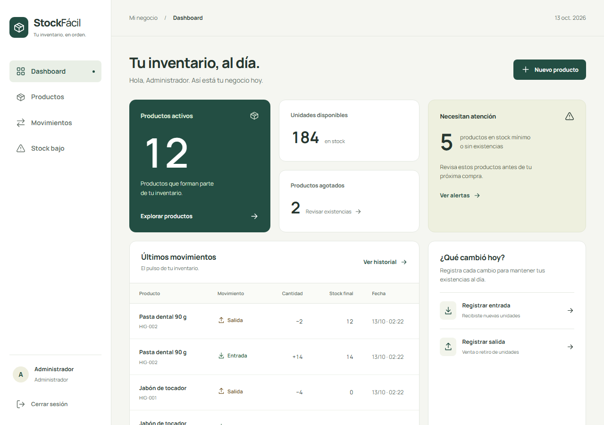
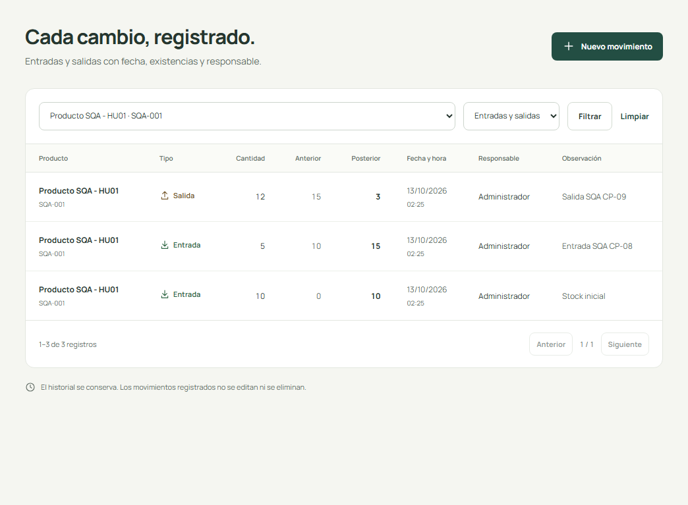

# INFORME GENERAL DE ASEGURAMIENTO DE LA CALIDAD - STOCKFÁCIL

## 1. Portada académica

| Dato | Valor |
| --- | --- |
| Universidad | [Completar nombre oficial] |
| Asignatura | [Completar] |
| Docente | [Completar] |
| Integrantes | [Completar nombres reales] |
| Proyecto | StockFácil |
| Historia | HU-01 y HU-02 |
| Fecha de elaboración | 13 de octubre de 2026 |
| Estado | Evaluación técnica preliminar; validación independiente pendiente |

## 2. Introducción

La actividad aplica controles de calidad a un sistema existente. Se eligieron el registro de productos y los movimientos porque conectan la calidad de los datos del catálogo con la consistencia de las existencias. Se documentan requisitos, implementación y pruebas reales, y se preparan los formatos para las evaluaciones humanas posteriores.

## 3. Descripción del sistema

StockFácil es una aplicación Laravel 13 con Blade, Tailwind CSS, Eloquent y SQLite local. Un administrador consulta el dashboard, registra/edita/desactiva productos, anota entradas/salidas, revisa alertas y consulta el historial. No se creó otro proyecto ni se reconstruyó el sistema para esta actividad.

## 4. Objetivos

- Comprobar los doce criterios originales de HU-01 y HU-02.
- Identificar artefactos reales y vincularlos con casos y evidencia.
- Preparar revisión, inspección y auditoría preliminares sin inventar participación externa.
- Registrar y corregir hallazgos pequeños, conservar antes/después y proteger SQLite de desarrollo.

## 5. Metodología SQA

Se examinó la estructura MVC, modelos/relaciones, migración, rutas, Requests, servicio y vistas, además de las pruebas y documentación. Se guardó la línea base con huellas SHA-256, se ejecutó PHPUnit en SQLite aislado y se capturaron formularios mediante Chromium en una instancia temporal. Se compararon seis CA por historia y se calculó el porcentaje sobre todos los aplicables.

La revisión de otro equipo, la sesión formal por pares y la auditoría independiente no están acreditadas. Sus campos y formatos quedan pendientes para personas reales. No se aportó una rúbrica/plan del curso; no se presupone su cumplimiento.

## 6. Historias seleccionadas

| Historia | Descripción | Alcance |
| --- | --- | --- |
| HU-01 | Como administrador de una tienda, quiero registrar nuevos productos con su información correspondiente para mantener actualizado el inventario de mi negocio. | Comprobar que el registro valida los datos, persiste un producto en SQLite y permite localizarlo en el inventario, conservando trazabilidad del stock inicial. |
| HU-02 | Como administrador de una tienda, quiero registrar las entradas y salidas de productos para controlar las cantidades disponibles en mi inventario. | Comprobar la aritmética de entradas y salidas, el rechazo de cantidades inválidas o insuficientes, la persistencia del historial y las alertas al llegar al mínimo. |

## 7. Resumen de revisiones

Se comprobó por historia la claridad del actor/objetivo, seis CA verificables, coherencia de requisitos, correspondencia de diseño, campos, validaciones, errores, flujo y artefactos. Los doce aspectos por historia tienen evidencia técnica identificada. La ratificación por otro equipo continúa pendiente.

HR-01 resolvió la ambigüedad de IDs CP con el namespace SQA/CP; HR-04 identificó concordancia incorrecta en el mensaje de cantidad. HR-02 y HR-03 documentan límites formales, no defectos del software.

## 8. Resumen de inspecciones

HU-01: diez elementos revisados sobre validación, unicidad, persistencia, entrada inicial, listado, errores, autenticación y organización MVC. HU-02: diez elementos sobre aritmética, cantidad, saldo insuficiente, historial, alertas, transacciones y protección del stock. Se prepararon actas con roles sin atribuir nombres, sesiones o firmas.

## 9. Resultados de pruebas funcionales

| Ejecución | Resultado | Interpretación |
| --- | --- | --- |
| Suite inicial | 42 aprobadas, 276 aserciones | Línea base funcional; no comprobaba concordancia. |
| Preparación del test de regresión | 3 errores, 5 aprobadas | Error en la llamada de aserción del test; corregido y archivado por separado. |
| Regresión válida anterior a HR-04 | 3 fallidas, 5 aprobadas | Reprodujo mensajes El cantidad para min/max; rechazo de operación sí funcionaba. |
| Suite final | 43 aprobadas, 286 aserciones; 0 fallos/errores/omitidas | Incluye límite superior y aserciones de redacción. |
| Navegador | 14/14 casos aprobados; CP-11/12 reejecutados y REG-MAX adicional | Capturas y JSON con resultados observados. |

Los intentos de creación inválidos no añadieron productos; el producto temporal quedó con movimientos 0 a 10, 10 a 15 y 15 a 3. Stock insuficiente, cero, negativo y exceso de límite conservaron saldo e historial. La prueba concurrente admitió una sola salida de 7 entre dos procesos sobre stock 10, saldo final 3.

## 10. Resultados técnicos preliminares de auditoría

| Historia | CA aplicables | Cumplen | No verificados | Técnico |
| --- | --- | --- | --- | --- |
| HU-01 | 6 | 6 | 0 | 100% |
| HU-02 | 6 | 6 | 0 | 100% |

Global: (12/12) x 100 = **100%** de los doce CA evaluados. No aplicables: 0. Pruebas bloqueadas de la actividad: 0. Es una preevaluación técnica pendiente de aprobación independiente; no es un porcentaje del sistema completo ni de la rúbrica del curso.

## 11. Comparación de historias

| Aspecto | HU-01 | HU-02 |
| --- | --- | --- |
| Riesgo evaluado | Calidad/duplicidad de datos del catálogo. | Consistencia de saldo y trazabilidad. |
| Artefacto central | ProductRequest y createProduct. | MovementRequest y record. |
| Casos de actividad | SQA/CP-01 a CP-07, siete aprobados. | SQA/CP-08 a CP-14, siete aprobados. |
| Persistencia | Producto y entrada inicial. | Entradas/salidas y saldos consecutivos. |
| Hallazgo funcional abierto | Ninguno en los CA ejecutados. | Ninguno en los CA ejecutados; HR-04 corregido. |
| Validación humana | Revisión, inspección y auditoría pendientes. | Revisión, inspección y auditoría pendientes. |

## 12. Hallazgos principales

| ID | Importancia | Descripción | Estado |
| --- | --- | --- | --- |
| HR-01 | Bajo | IDs CP entre catálogos diferentes. | Corregido documentalmente. |
| HR-02 | Medio, proceso | Falta ratificación externa y sesión formal por pares. | Pendiente. |
| HR-03 | Medio, alcance | Rúbrica/plan y aprobación independiente no aportados. | Pendiente. |
| HR-04 | Bajo, claridad | Concordancia El cantidad en mensajes de rango. | Corregido y verificado; evidencia anterior conservada. |

## 13. Acciones correctivas

La corrección de producción se limita a MovementRequest::messages para quantity.min/max. InventoryTest añade comprobaciones de texto y el límite superior. No se alteraron reglas de saldo ni arquitectura. El primer intento de preparar la regresión se corrigió antes de usarlo como evidencia del producto. Las pruebas válidas antes/después, capturas y huellas permiten reconstruir la acción.

La ambigüedad de casos se resuelve dentro de docs/sqa, sin reescribir el catálogo previo. Los responsables humanos del cierre académico, los plazos y las firmas son campos pendientes de los equipos reales.

## 14. Recomendaciones

- Entregar los informes, sus fuentes Markdown y la evidencia original; no solo el porcentaje.
- Revisar con otro equipo las fichas y completar observaciones de requisitos/diseño.
- Realizar inspección formal por pares con roles, acuerdos y firmas en las dos actas.
- Facilitar la rúbrica al auditor y registrar un resultado independiente, con fecha real.
- Mantener SQLite aislado y los casos de regresión al modificar catálogo o inventario.

## 15. Conclusiones generales

Los doce CA se comprobaron mediante código, pruebas HTTP y formularios reales. El catálogo valida y persiste; las existencias se actualizan y mantienen historial coherente. Se corrigió un defecto menor de redacción y se conservó la evidencia inicial. La huella lógica del inventario de desarrollo coincide antes y después, con 12 productos, 24 movimientos y 184 unidades activas.

El resultado técnico es 100% de los doce CA aplicables. La actividad académica aún requiere los participantes externos y el docente: este paquete prepara la evaluación formal y no suplanta sus conclusiones.

## 16. Anexos y evidencias

- [Fichas](../01-preparacion/historias-usuario.md).
- [CA originales](../01-preparacion/criterios-aceptacion.md).
- [Trazabilidad](../01-preparacion/matriz-trazabilidad.md).
- [Hallazgos](../02-revision/hallazgos-revision.md).
- [Acciones](../03-inspeccion/registro-acciones-correctivas.md).
- [Casos detallados](../04-pruebas/casos-prueba.md).
- [Resultados](../04-pruebas/resultados-pruebas.md).
- [Validación pendiente](../05-auditoria/validacion-independiente-pendiente.md).
- [Informe independiente HU-01](informe-sqa-hu01.md).
- [Informe independiente HU-02](informe-sqa-hu02.md).
- [phpunit-junit.xml](../04-pruebas/evidencias/phpunit-junit.xml).
- [phpunit-salida.txt](../04-pruebas/evidencias/phpunit-salida.txt).
- [phpunit-antes.xml](../04-pruebas/evidencias/phpunit-antes.xml).
- [regresion-antes.xml](../04-pruebas/evidencias/regresion-antes.xml).
- [resultados-navegador.json](../04-pruebas/evidencias/resultados-navegador.json).
- [revalidacion-correccion.json](../04-pruebas/evidencias/revalidacion-correccion.json).
- [sqlite-navegador.json](../04-pruebas/evidencias/sqlite-navegador.json).
- [integridad-final.json](../04-pruebas/evidencias/integridad-final.json).
- [referencias-codigo.json](../04-pruebas/evidencias/referencias-codigo.json).
- [fuentes-inspeccionadas.txt](../04-pruebas/evidencias/fuentes-inspeccionadas.txt).

### Captura: Dashboard real de la instancia temporal, antes de los casos.

Evidencia original: [dashboard.png](../04-pruebas/evidencias/dashboard.png).

### Captura: Producto SQA-001 registrado y consultable.

Evidencia original: [hu01-producto-listado.png](../04-pruebas/evidencias/hu01-producto-listado.png).

### Captura: Historial coherente de la secuencia ejecutada.

Evidencia original: [hu02-historial.png](../04-pruebas/evidencias/hu02-historial.png).
