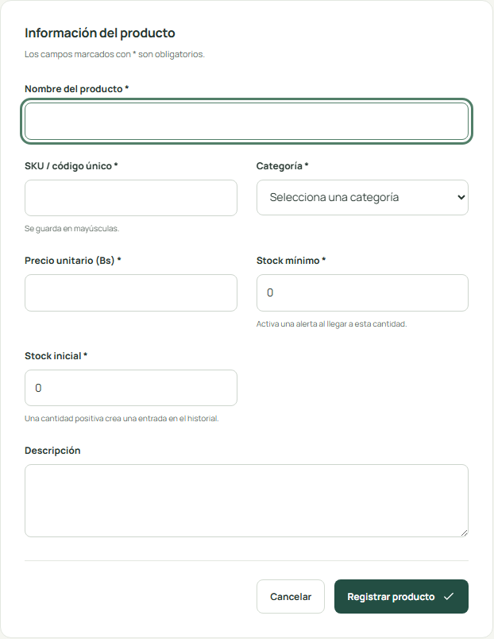
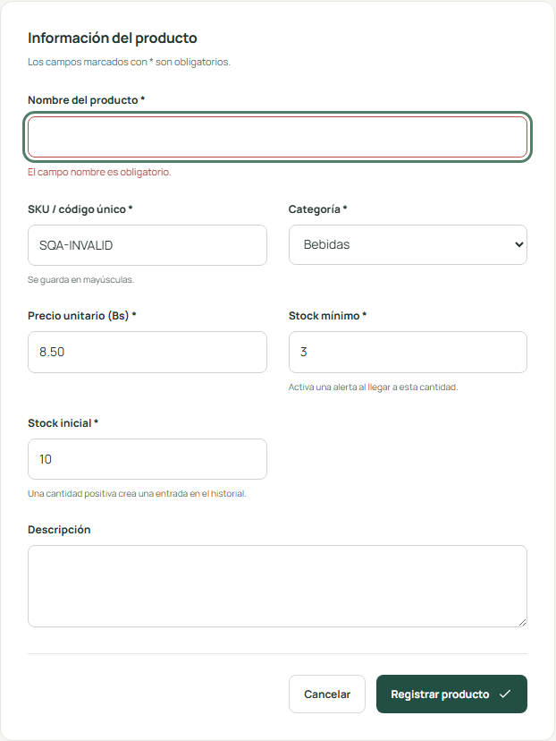
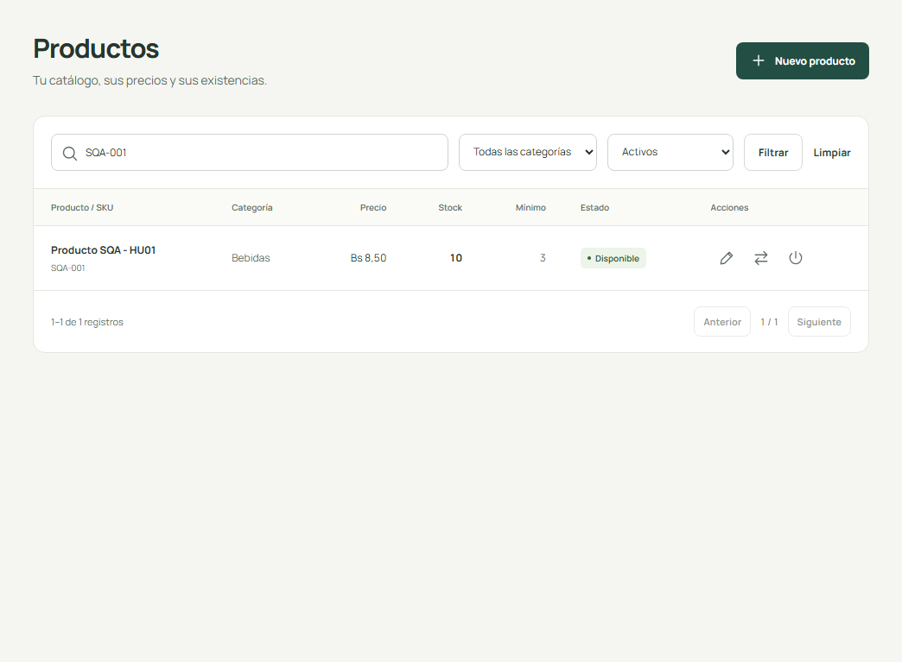

# INFORME SQA - HU-01 REGISTRO DE PRODUCTOS

## 1. Datos generales

| Dato | Valor |
| --- | --- |
| Universidad | [Completar nombre oficial] |
| Asignatura | [Completar] |
| Docente | [Completar] |
| Integrantes | [Completar nombres reales] |
| Proyecto | StockFácil |
| Historia | HU-01 |
| Fecha de elaboración | 13 de octubre de 2026 |
| Estado | Evaluación técnica preliminar; validación independiente pendiente |

## 2. Introducción

El registro de productos es la entrada del inventario: un error en nombre, SKU, precio o cantidad inicial afecta la calidad de los datos posteriores. Se revisaron requisitos, se inspeccionó la implementación y se ejecutaron formularios reales sobre una base de pruebas.

Este informe distingue la revisión e inspección técnicas preliminares de las actividades humanas exigidas por la consigna. Las actas y la auditoría quedan listas para su validación; no se acredita una participación externa inexistente.

## 3. Objetivo

Comprobar que el registro valida los datos, persiste un producto en SQLite y permite localizarlo en el inventario, conservando trazabilidad del stock inicial.

## 4. Descripción de la historia

Como administrador de una tienda, quiero registrar nuevos productos con su información correspondiente para mantener actualizado el inventario de mi negocio.

### Criterios originales

- CA-01: El sistema debe exigir el nombre del producto.
- CA-02: El SKU o código del producto debe ser único.
- CA-03: El precio no puede ser negativo.
- CA-04: La cantidad inicial no puede ser negativa.
- CA-05: Cuando se registre correctamente un producto, este debe aparecer en el inventario.
- CA-06: Cuando se ingresen datos inválidos, el sistema debe mostrar mensajes de validación.

### Alcance complementario

Se comprobó stock inicial trazable, SKU en mayúsculas, edición sin cambio directo de stock y conservación de productos inactivos. El stock cero inicial es válido y no crea un movimiento cero.

## 5. Artefactos relacionados

| Ref. | Archivo y línea verificados | Clase, método o artefacto |
| --- | --- | --- |
| P1 | `app/Http/Requests/ProductRequest.php:23` | ProductRequest::rules |
| P2 | `app/Http/Controllers/ProductController.php:37` | ProductController::store |
| P3 | `app/Http/Controllers/ProductController.php:16` | ProductController::index |
| P4 | `app/Services/InventoryService.php:13` | InventoryService::createProduct |
| P5 | `resources/views/products/form.blade.php:3` | Formulario Blade de creación y edición |
| P6 | `resources/views/products/index.blade.php:11` | Listado Blade paginado |
| P7 | `database/migrations/2026_10_13_000001_create_inventory_tables.php:17` | Migración: productos y restricciones SQLite |
| P8 | `app/Models/Product.php:17` | Product::category / movements / casts |
| C1 | `resources/views/components/field.blade.php:6` | Componente: etiqueta, ayuda y error del campo |
| C2 | `resources/views/components/flash.blade.php:4` | Componente: resumen de errores y confirmación |
| C3 | `lang/es/validation.php:4` | Mensajes de validación en español |
| C4 | `bootstrap/app.php:19` | Respuesta de validación: recuperación segura de campos escalares |
| A1 | `routes/web.php:14` | Grupo de rutas protegido por auth |
| B1 | `config/database.php:6` | Conexión SQLite, WAL y espera de escritura |
| T1 | `tests/Feature/ProductTest.php:34` | ProductTest: registro válido, invalidaciones y listado |
| T4 | `tests/Feature/AuthenticationTest.php:14` | AuthenticationTest: rutas internas protegidas |
| T5 | `phpunit.xml:24` | SQLite de pruebas en memoria |

Documentación examinada: README.md; docs/historias-usuario.md; docs/arquitectura.md; docs/casos-prueba.md; docs/verificacion.md; PRODUCT.md y DESIGN.md. No se localizaron mockups previos; las capturas anexas son posteriores a la implementación.

## 6. Evidencia de revisión

| N.º | Aspecto | Resultado | Observación y evidencia |
| --- | --- | --- | --- |
| 1 | Descripción clara | Cumple | Registro para actualizar inventario, con actor y finalidad explícitos. Evidencia: Ficha y consigna |
| 2 | Actor identificado | Cumple | Administrador de tienda; las rutas exigen sesión. Evidencia: A1, T4 |
| 3 | Objetivo comprensible | Cumple | Conservar un catálogo válido y localizar el producto creado. Evidencia: Ficha HU-01 |
| 4 | Criterios definidos | Cumple | Seis CA originales conservados sin reformulación. Evidencia: Criterios CA-01 a CA-06 |
| 5 | Criterios verificables | Cumple | Cada CA se vincula con entrada, rechazo o presencia de una fila. Evidencia: SQA/CP-01 a CP-07, T1 |
| 6 | Ausencia de contradicciones en el alcance seleccionado | Cumple | Inicial cero es válido; no produce movimiento cero. No contradice el rechazo de movimientos cero. Evidencia: P1, P4, T1 |
| 7 | Diseño acorde con la funcionalidad | Cumple | Formulario, confirmación y búsqueda corresponden al registro real. Evidencia: P5, P6, capturas HU-01 |
| 8 | Campos necesarios en formularios | Cumple | Nombre, SKU, categoría, descripción, precio, inicial y mínimo presentes. Evidencia: P5; hu01-formulario.png |
| 9 | Validaciones contempladas | Cumple | required, unique, numeric, integer y mínimos en el servidor. Evidencia: P1; pruebas negativas |
| 10 | Mensajes de error contemplados | Cumple | Resumen y errores por campo, en español; valores válidos conservados. Evidencia: C1 a C4; CP-07 |
| 11 | Flujo de uso coherente | Cumple | Formulario POST, transacción, redirección y listado paginado/buscable. Evidencia: P2 a P6; CP-01/06 |
| 12 | Artefactos identificables | Cumple | Modelos, migración, rutas, vistas, pruebas y documentación reales. Evidencia: Inventario de artefactos P1 a T5 |

### Hallazgos y acciones

HR-01: IDs CP ambiguos entre catálogos; resuelto al usar SQA/CP y vincular métodos reales. HR-02: revisión externa e inspección por pares pendientes. HR-03: rúbrica y auditoría independiente no aportadas. No se encontró un defecto funcional de registro en los seis CA ejecutados.

Equipo revisor: [Completar]. Integrantes: [Completar]. Fecha externa: [Completar]. Firma/validación: [Completar]. Observaciones adicionales: [Completar].

## 7. Evidencia de inspección

| ID | Elemento | Resultado | Observación y evidencia |
| --- | --- | --- | --- |
| I01-01 | Nombre obligatorio | Cumple | CP-02 rechaza nombre vacío; error visible. Evidencia: SQA/CP-02, T1 |
| I01-02 | SKU único | Cumple | Unique en petición e índice SQLite; minúsculas se normalizan. Evidencia: SQA/CP-03, T1 |
| I01-03 | Precio | Cumple | numeric, min:0 y hasta dos decimales. Evidencia: SQA/CP-04, T1 |
| I01-04 | Stock inicial | Cumple | Rechazo de negativo/fraccionario; cero permitido. Evidencia: SQA/CP-05, T1 |
| I01-05 | Persistencia SQLite | Cumple | Eloquent escribe producto; base temporal muestra SQA-001. Evidencia: sqlite-navegador.json, CP-01 |
| I01-06 | Movimiento inicial | Cumple | Entrada 0 a 10; con cero no hay movimiento; fallo revierte producto. Evidencia: T1; sqlite-navegador.json |
| I01-07 | Producto en listado | Cumple | Fila filtrada por SKU muestra datos y stock 10. Evidencia: SQA/CP-06 |
| I01-08 | Mensajes de error | Cumple | Resumen, mensaje por campo, aria-invalid y SKU recuperado. Evidencia: SQA/CP-07 |
| I01-09 | Autenticación | Cumple | Sin sesión, lectura y POST redirigen a login. Evidencia: T4; phpunit-junit.xml |
| I01-10 | Organización del código | Cumple | Request valida, controlador coordina y servicio persiste; Pint aprobado. Evidencia: pint-salida.txt, fuentes-inspeccionadas.txt |

### Acta preliminar

Proyecto: StockFácil. Historia: HU-01, Registro de productos.

- Fecha de elaboración preliminar: 13 de octubre de 2026.
- Fecha de sesión formal: [Completar].
- Modalidad preliminar: lectura técnica asistida, pruebas HTTP automatizadas y navegador sobre SQLite aislado.
- Modalidad de inspección formal: [Completar].
- Objetivo: Comprobar que el registro valida los datos, persiste un producto en SQLite y permite localizarlo en el inventario, conservando trazabilidad del stock inicial.
- Alcance: diez elementos de implementación y documentación identificados en el checklist; no certifica estándares del curso no aportados.
- Preparación técnica: Codex, herramienta de asistencia; no constituye un participante humano ni revisor independiente.
- Moderador: [Nombre, equipo y firma].
- Autor o representante del equipo de desarrollo: [Nombre y firma].
- Inspector o lector: [Nombre, equipo y firma].
- Secretario: [Nombre y firma].

Procedimiento realizado: lectura de artefactos, comparación de los seis CA originales, consulta de rutas y migración, ejecución de PHPUnit, captura de formularios reales y contraste del estado SQLite. Los intentos inválidos se enviaron con noValidate para probar las reglas del servidor.

Artefactos inspeccionados: referencias P1, P2, P3, P4, P5, P6, P7, P8, C1, C2, C3, C4, A1, B1, T1, T4, T5; inventario con archivos y líneas en este paquete. Las capturas corresponden a la interfaz ya implementada; no son mockups previos.

Hallazgos: HR-01, ambigüedad entre catálogos CP, corregido documentalmente; HR-02 y HR-03, actividades formales y rúbrica pendientes. No se detectó un defecto funcional en los seis CA de registro.

Acciones y responsables: AC-01 y AC-02 ejecutadas técnicamente por Codex; equipo humano responsable de ratificarlas: [Completar]. AC-03 corresponde al equipo revisor/pares [Completar] y AC-04 al docente o auditor designado [Completar]. No se asigna un plazo inventado; fecha compromiso de cada equipo: [Completar].

Estado: inspección técnica preliminar completada; inspección formal por pares pendiente. Conclusión preliminar: los elementos comprobados cumplen el alcance implementado, con la limitación de no contar con aprobación de participantes externos. Acuerdos de la sesión real y conclusión formal: [Completar después de inspeccionar].

Firmas de participantes y validación del acta: [Completar].

Checklist completo de ocho columnas: [Anexo de inspección](../03-inspeccion/checklist-inspeccion-hu01.md).

## 8. Casos de prueba y resultados reales

### SQA/CP-01: Registrar producto válido

| Campo | Contenido |
| --- | --- |
| Precondiciones | Sesión de administrador, categoría Bebidas y SKU SQA-001 libre. |
| Entrada y pasos | Nombre Producto SQA - HU01; SKU SQA-001; precio 8,50; inicial 10; mínimo 3. Abrir Nuevo producto; completar campos; pulsar Registrar producto. |
| Resultado esperado | Confirmación, persistencia del producto y entrada inicial 0 a 10. |
| Resultado obtenido | Producto registrado. El stock inicial quedó en el historial. |
| Estado y evidencia | Aprobado; [hu01-registro-exitoso.png](../04-pruebas/evidencias/hu01-registro-exitoso.png) |

### SQA/CP-02: Rechazar producto sin nombre

| Campo | Contenido |
| --- | --- |
| Precondiciones | Sesión iniciada y formulario disponible. |
| Entrada y pasos | Nombre vacío; SKU SQA-INVALID; precio 8,50; inicial 10; mínimo 3. Enviar el formulario con nombre vacío, omitiendo solo la validación nativa del navegador. |
| Resultado esperado | Mensaje de nombre obligatorio; sin nuevo producto. |
| Resultado obtenido | El campo nombre es obligatorio. |
| Estado y evidencia | Aprobado; [hu01-error-nombre.png](../04-pruebas/evidencias/hu01-error-nombre.png) |

### SQA/CP-03: Rechazar SKU duplicado

| Campo | Contenido |
| --- | --- |
| Precondiciones | CP-01 creó SQA-001. |
| Entrada y pasos | SKU SQA-001; otros campos válidos. Abrir Nuevo producto e intentar guardar el SKU existente. |
| Resultado esperado | Mensaje de SKU duplicado; sin duplicación en SQLite. |
| Resultado obtenido | El SKU ya está registrado. Usa otro valor. |
| Estado y evidencia | Aprobado; [hu01-error-sku.png](../04-pruebas/evidencias/hu01-error-sku.png) |

### SQA/CP-04: Rechazar precio negativo

| Campo | Contenido |
| --- | --- |
| Precondiciones | Sesión iniciada, categoría válida. |
| Entrada y pasos | Precio -1; SKU SQA-INVALID; otros campos válidos. Enviar el formulario omitiendo validación HTML5 para ejercitar el servidor. |
| Resultado esperado | Mensaje de precio no negativo; producto no persistido. |
| Resultado obtenido | El precio debe ser mayor o igual a 0. |
| Estado y evidencia | Aprobado; [hu01-error-precio.png](../04-pruebas/evidencias/hu01-error-precio.png) |

### SQA/CP-05: Rechazar stock inicial negativo

| Campo | Contenido |
| --- | --- |
| Precondiciones | Sesión iniciada, categoría válida. |
| Entrada y pasos | Stock inicial -1; SKU SQA-INVALID; otros campos válidos. Enviar el formulario omitiendo validación HTML5 para ejercitar el servidor. |
| Resultado esperado | Mensaje de stock inicial no negativo; sin producto ni movimiento. |
| Resultado obtenido | El stock inicial debe ser mayor o igual a 0. |
| Estado y evidencia | Aprobado; [hu01-error-stock-inicial.png](../04-pruebas/evidencias/hu01-error-stock-inicial.png) |

### SQA/CP-06: Localizar producto guardado

| Campo | Contenido |
| --- | --- |
| Precondiciones | CP-01 aprobado; errores previos no añadieron productos. |
| Entrada y pasos | Filtro de búsqueda SQA-001. Abrir Productos, buscar el SKU y comprobar la fila. |
| Resultado esperado | Una fila con nombre, SKU, precio y stock 10. |
| Resultado obtenido | Producto SQA-001 visible en el listado filtrado, Bs 8,50 y stock 10. |
| Estado y evidencia | Aprobado; [hu01-producto-listado.png](../04-pruebas/evidencias/hu01-producto-listado.png) |

### SQA/CP-07: Visualizar errores de validación

| Campo | Contenido |
| --- | --- |
| Precondiciones | Sesión iniciada y formulario disponible. |
| Entrada y pasos | Nombre vacío; SKU SQA-ERROR; otros campos válidos. Enviar, comprobar resumen de errores, mensaje junto al nombre, aria-invalid y conservación del SKU. |
| Resultado esperado | Errores visibles y entrada válida recuperada. |
| Resultado obtenido | Resumen y mensaje junto al nombre visibles; SKU conservado y aria-invalid=true. |
| Estado y evidencia | Aprobado; [hu01-mensajes-validacion.png](../04-pruebas/evidencias/hu01-mensajes-validacion.png) |

Suite completa después de HR-04: 43 pruebas aprobadas y 286 aserciones, sin errores, fallos ni omitidas. Los 14 casos de actividad se ejecutaron en navegador; siete corresponden a esta historia. Las variantes PHPUnit usan SQLite en memoria y pueden tener datos diferentes a la secuencia de navegador; por ejemplo, salida 10 - 7 en PHPUnit y 15 - 12 en navegador.

## 9. Resultado de auditoría

**Preevaluación técnica, pendiente de auditoría independiente.**

| CA | Criterio original | Resultado | Evidencia |
| --- | --- | --- | --- |
| CA-01 | El sistema debe exigir el nombre del producto. | Cumple | P1, P5; SQA/CP-02 |
| CA-02 | El SKU o código del producto debe ser único. | Cumple | P1, P7; SQA/CP-03 |
| CA-03 | El precio no puede ser negativo. | Cumple | P1, P7; SQA/CP-04 |
| CA-04 | La cantidad inicial no puede ser negativa. | Cumple | P1, P4; SQA/CP-05 |
| CA-05 | Cuando se registre correctamente un producto, este debe aparecer en el inventario. | Cumple | P2, P3, P6; SQA/CP-01, SQA/CP-06 |
| CA-06 | Cuando se ingresen datos inválidos, el sistema debe mostrar mensajes de validación. | Cumple | C1, C2, C3, C4; SQA/CP-02, SQA/CP-07 |

Cumplimiento verificado: (6/6) x 100 = **100%**. No verificados: 0 CA. No aplicables: 0. Pruebas bloqueadas: 0. El plan/rúbrica del curso y la aprobación oficial son No verificado y quedan fuera de este porcentaje de CA.

- Equipo externo o auditor designado: [Completar].
- Integrantes y roles: [Completar].
- Fecha de actividad formal: [Completar].
- Observaciones oficiales: [Completar].
- Resultado aprobado por el responsable independiente: [Completar].
- Firma o validación: [Completar].

La elaboración técnica por Codex no acredita la participación de otro equipo, una reunión de inspección ni una auditoría del docente.

## 10. Recomendaciones

Mantener la normalización de SKU y la restricción única de SQLite; conservar el registro inicial transaccional; usar la búsqueda o paginación para localizar productos; someter los criterios y la ficha a la revisión del otro equipo.

Solicitar revisión de otro equipo, completar roles/firmas de pares y registrar el resultado del auditor independiente con su fecha real.

## 11. Conclusiones

Los casos válidos e inválidos demuestran que el catálogo se registra con validación y que el producto queda consultable en SQLite. La entrada inicial conserva trazabilidad y los intentos rechazados no crean registros. El 100% técnico de seis CA se respalda con pruebas y capturas, aunque aún no acredita la revisión externa, la inspección formal ni la aprobación docente.

No se reinició ni modificó el inventario de desarrollo: la huella lógica antes/después coincide.

## 12. Anexos

- [JUnit de ejecución final](../04-pruebas/evidencias/phpunit-junit.xml) y [salida completa](../04-pruebas/evidencias/phpunit-salida.txt).
- [casos reales de navegador](../04-pruebas/evidencias/resultados-navegador.json) y [persistencia en SQLite temporal](../04-pruebas/evidencias/sqlite-navegador.json).
- [código con líneas](../04-pruebas/evidencias/fuentes-inspeccionadas.txt), [mapa de referencias](../04-pruebas/evidencias/referencias-codigo.json) y [integridad de desarrollo](../04-pruebas/evidencias/integridad-final.json).
- [Registro de hallazgos](../02-revision/hallazgos-revision.md) y [acciones correctivas](../03-inspeccion/registro-acciones-correctivas.md).

### Figura 1. Formulario real de productos, posterior a implementación.

Captura real de Chromium sobre SQLite temporal; el archivo original está disponible en [hu01-formulario.png](../04-pruebas/evidencias/hu01-formulario.png).

### Figura 2. Rechazo del nombre vacío en el servidor.

Captura real de Chromium sobre SQLite temporal; el archivo original está disponible en [hu01-error-nombre.png](../04-pruebas/evidencias/hu01-error-nombre.png).

### Figura 3. Producto persistido visible mediante búsqueda por SKU.

Captura real de Chromium sobre SQLite temporal; el archivo original está disponible en [hu01-producto-listado.png](../04-pruebas/evidencias/hu01-producto-listado.png).
