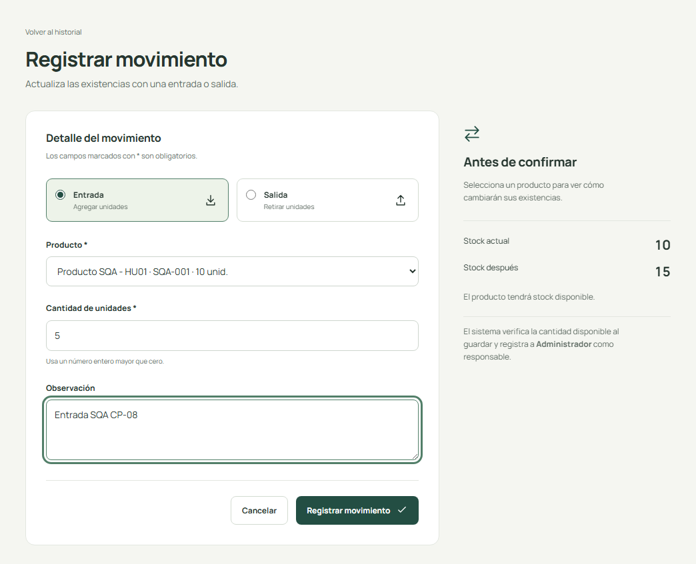
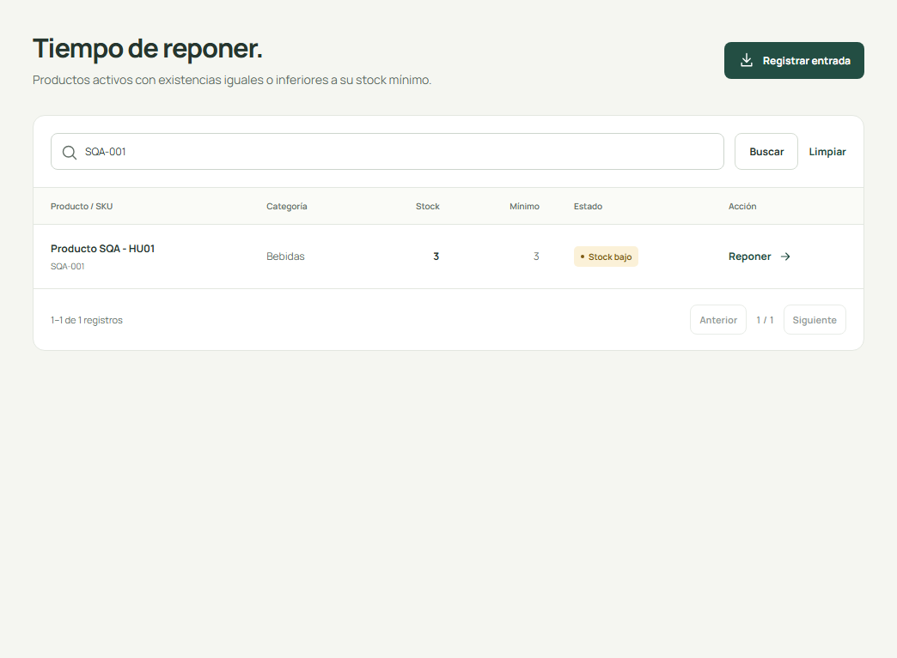
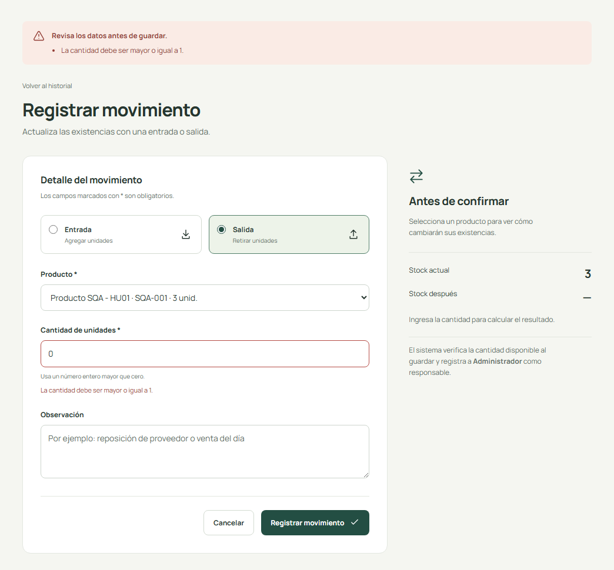

# INFORME SQA - HU-02 CONTROL DE ENTRADAS Y SALIDAS DE INVENTARIO

## 1. Datos generales

| Dato | Valor |
| --- | --- |
| Universidad | [Completar nombre oficial] |
| Asignatura | [Completar] |
| Docente | [Completar] |
| Integrantes | [Completar nombres reales] |
| Proyecto | StockFácil |
| Historia | HU-02 |
| Fecha de elaboración | 13 de octubre de 2026 |
| Estado | Evaluación técnica preliminar; validación independiente pendiente |

## 2. Introducción

Cada movimiento cambia un saldo compartido. La evaluación se concentró en los límites de cantidad, la consistencia entre stock e historial y el aviso de reposición. El servicio transaccional y las pruebas concurrentes aportan evidencia adicional a los casos visibles de la interfaz.

Este informe distingue la revisión e inspección técnicas preliminares de las actividades humanas exigidas por la consigna. Las actas y la auditoría quedan listas para su validación; no se acredita una participación externa inexistente.

## 3. Objetivo

Comprobar la aritmética de entradas y salidas, el rechazo de cantidades inválidas o insuficientes, la persistencia del historial y las alertas al llegar al mínimo.

## 4. Descripción de la historia

Como administrador de una tienda, quiero registrar las entradas y salidas de productos para controlar las cantidades disponibles en mi inventario.

### Criterios originales

- CA-01: Las entradas deben incrementar correctamente las existencias.
- CA-02: Las salidas deben disminuir correctamente las existencias.
- CA-03: No se debe permitir retirar más productos de los disponibles.
- CA-04: No se deben permitir movimientos con cantidades iguales o menores a cero.
- CA-05: Cada entrada y salida debe quedar registrada en el historial.
- CA-06: El sistema debe mostrar alertas cuando un producto alcance su stock mínimo.

### Alcance complementario

Se comprobó cantidad entera, producto activo, responsable autenticado, rollback, saldos obsoletos y dos salidas concurrentes. La alerta usa <= mínimo e incluye el mínimo exacto solicitado.

## 5. Artefactos relacionados

| Ref. | Archivo y línea verificados | Clase, método o artefacto |
| --- | --- | --- |
| M1 | `app/Http/Requests/MovementRequest.php:17` | MovementRequest::rules |
| M2 | `app/Services/InventoryService.php:31` | InventoryService::record |
| M3 | `app/Http/Controllers/MovementController.php:34` | MovementController::store |
| M4 | `app/Http/Controllers/MovementController.php:16` | MovementController::index |
| M5 | `app/Models/Movement.php:16` | Movement: atributos, casts y relaciones |
| M6 | `resources/views/movements/form.blade.php:4` | Formulario Blade de movimientos |
| M7 | `resources/views/movements/index.blade.php:4` | Historial Blade |
| M8 | `app/Models/Product.php:37` | Product::scopeLowStock / getStockStatusAttribute |
| M9 | `resources/views/products/low-stock.blade.php:4` | Listado Blade de alertas |
| M10 | `app/Http/Requests/MovementRequest.php:32` | MovementRequest::messages, corrección HR-04 |
| P7 | `database/migrations/2026_10_13_000001_create_inventory_tables.php:17` | Migración: productos y restricciones SQLite |
| P8 | `app/Models/Product.php:17` | Product::category / movements / casts |
| C1 | `resources/views/components/field.blade.php:6` | Componente: etiqueta, ayuda y error del campo |
| C2 | `resources/views/components/flash.blade.php:4` | Componente: resumen de errores y confirmación |
| A1 | `routes/web.php:14` | Grupo de rutas protegido por auth |
| B1 | `config/database.php:6` | Conexión SQLite, WAL y espera de escritura |
| T2 | `tests/Feature/InventoryTest.php:39` | InventoryTest: entradas, salidas, alertas y rollback |
| T3 | `tests/Feature/ConcurrencyTest.php:14` | ConcurrencyTest: dos procesos sobre SQLite temporal |
| T4 | `tests/Feature/AuthenticationTest.php:14` | AuthenticationTest: rutas internas protegidas |
| T5 | `phpunit.xml:24` | SQLite de pruebas en memoria |

Documentación examinada: README.md; docs/historias-usuario.md; docs/arquitectura.md; docs/casos-prueba.md; docs/verificacion.md; PRODUCT.md y DESIGN.md. No se localizaron mockups previos; las capturas anexas son posteriores a la implementación.

## 6. Evidencia de revisión

| N.º | Aspecto | Resultado | Observación y evidencia |
| --- | --- | --- | --- |
| 1 | Descripción clara | Cumple | Registro de entradas y salidas para controlar cantidades. Evidencia: Ficha y consigna |
| 2 | Actor identificado | Cumple | Administrador autenticado; responsable extraído de la sesión. Evidencia: A1, M3, T4 |
| 3 | Objetivo comprensible | Cumple | Conocer el saldo y conservar cambios verificables. Evidencia: Ficha HU-02 |
| 4 | Criterios definidos | Cumple | Seis CA originales conservados; reglas adicionales separadas. Evidencia: Criterios CA-01 a CA-06 |
| 5 | Criterios verificables | Cumple | Saldos antes/después, rechazos, historial y mínimo exacto observables. Evidencia: SQA/CP-08 a CP-14, T2 |
| 6 | Ausencia de contradicciones en el alcance seleccionado | Cumple | Cantidad positiva para movimientos; alerta con <= incluye el mínimo exigido. Evidencia: M1, M2, M8 |
| 7 | Diseño acorde con la funcionalidad | Cumple | Tipos Entrada/Salida y preview respaldados por validación del servidor. Evidencia: M6, M2; capturas HU-02 |
| 8 | Campos necesarios en formularios | Cumple | Producto, tipo, cantidad y observación; responsable/fecha automáticos. Evidencia: M6, M3, M5 |
| 9 | Validaciones contempladas | Cumple | Producto activo, cantidad entera positiva, tipo y saldo suficiente. Evidencia: M1, M2, T2 |
| 10 | Mensajes de error contemplados | Cumple | Errores de insuficiencia y cantidad presentes; concordancia corregida en HR-04. Evidencia: CP-10/11/12, M10 |
| 11 | Flujo de uso coherente | Cumple | Selección, preview, guardado atómico, historial y alerta. Evidencia: M2 a M9; navegador |
| 12 | Artefactos identificables | Cumple | Servicio, controladores, modelos, migración, pruebas y docs identificados. Evidencia: Inventario de artefactos M1 a T5 |

### Hallazgos y acciones

HR-01: namespace SQA/CP establecido. HR-02/03: actividades formales y rúbrica pendientes. HR-04: el mensaje decía «El cantidad»; se corrigió mediante MovementRequest::messages para min/max. La regresión válida tuvo tres fallos de texto antes del cambio; después, la suite completa y las capturas de cero/negativo/límite aprobaron. La operación inválida ya se rechazaba antes y el saldo se conservó.

Equipo revisor: [Completar]. Integrantes: [Completar]. Fecha externa: [Completar]. Firma/validación: [Completar]. Observaciones adicionales: [Completar].

## 7. Evidencia de inspección

| ID | Elemento | Resultado | Observación y evidencia |
| --- | --- | --- | --- |
| I02-01 | Entradas | Cumple | 10 + 5 = 15; historial persiste saldos. Evidencia: SQA/CP-08, T2 |
| I02-02 | Salidas | Cumple | 15 - 12 = 3 en navegador; prueba aislada 10 - 7 = 3. Evidencia: SQA/CP-09, T2 |
| I02-03 | Stock actualizado | Cumple | Servicio relee después de adquirir escritura y actualiza condicionalmente. Evidencia: T2 modelo desactualizado, T3 |
| I02-04 | Stock insuficiente | Cumple | Salida 4 sobre saldo 3 rechazada; no nuevo historial. Evidencia: SQA/CP-10, T2 |
| I02-05 | Cantidad válida | Cumple | 0, -1 y exceso de límite rechazados; mensajes corregidos. Evidencia: CP-11/12, REG-MAX, T2 |
| I02-06 | Historial | Cumple | Tres registros con tipo, cantidad, saldos, fecha, usuario y notas; sin rutas de edición/borrado. Evidencia: SQA/CP-13, T2 |
| I02-07 | Alertas | Cumple | Stock 3 igual a mínimo 3 produce Stock bajo. Evidencia: SQA/CP-14, T2 |
| I02-08 | Transacciones | Cumple | WAL, espera y primera escritura; rollback probado; dos procesos no venden de más. Evidencia: T2 rollback, T3 |
| I02-09 | Stock protegido | Cumple | stock prohibido en formularios; no fillable; movimientos solo en activos. Evidencia: T1 edición, T2 inactivo |
| I02-10 | Lógica de negocio | Cumple | Reglas centralizadas en servicio; mensajes específicos en Request; Pint aprobado. Evidencia: M2, M10, pint-salida.txt |

### Acta preliminar

Proyecto: StockFácil. Historia: HU-02, Control de entradas y salidas de inventario.

- Fecha de elaboración preliminar: 13 de octubre de 2026.
- Fecha de sesión formal: [Completar].
- Modalidad preliminar: lectura técnica asistida, pruebas HTTP automatizadas y navegador sobre SQLite aislado.
- Modalidad de inspección formal: [Completar].
- Objetivo: Comprobar la aritmética de entradas y salidas, el rechazo de cantidades inválidas o insuficientes, la persistencia del historial y las alertas al llegar al mínimo.
- Alcance: diez elementos de implementación y documentación identificados en el checklist; no certifica estándares del curso no aportados.
- Preparación técnica: Codex, herramienta de asistencia; no constituye un participante humano ni revisor independiente.
- Moderador: [Nombre, equipo y firma].
- Autor o representante del equipo de desarrollo: [Nombre y firma].
- Inspector o lector: [Nombre, equipo y firma].
- Secretario: [Nombre y firma].

Procedimiento realizado: lectura de artefactos, comparación de los seis CA originales, consulta de rutas y migración, ejecución de PHPUnit, captura de formularios reales y contraste del estado SQLite. Los intentos inválidos se enviaron con noValidate para probar las reglas del servidor.

Artefactos inspeccionados: referencias M1, M2, M3, M4, M5, M6, M7, M8, M9, M10, P7, P8, C1, C2, A1, B1, T2, T3, T4, T5; inventario con archivos y líneas en este paquete. Las capturas corresponden a la interfaz ya implementada; no son mockups previos.

Hallazgos: HR-01, ambigüedad entre catálogos CP, corregido documentalmente; HR-02 y HR-03, actividades formales y rúbrica pendientes. HR-04, concordancia del mensaje de cantidad, corregido y comprobado antes/después.

Acciones y responsables: AC-01 y AC-02 ejecutadas técnicamente por Codex; equipo humano responsable de ratificarlas: [Completar]. AC-03 corresponde al equipo revisor/pares [Completar] y AC-04 al docente o auditor designado [Completar]. No se asigna un plazo inventado; fecha compromiso de cada equipo: [Completar].

Estado: inspección técnica preliminar completada; inspección formal por pares pendiente. Conclusión preliminar: los elementos comprobados cumplen el alcance implementado, con la limitación de no contar con aprobación de participantes externos. Acuerdos de la sesión real y conclusión formal: [Completar después de inspeccionar].

Firmas de participantes y validación del acta: [Completar].

Checklist completo de ocho columnas: [Anexo de inspección](../03-inspeccion/checklist-inspeccion-hu02.md).

## 8. Casos de prueba y resultados reales

### SQA/CP-08: Registrar entrada válida

| Campo | Contenido |
| --- | --- |
| Precondiciones | Producto SQA-001 activo con stock 10. |
| Entrada y pasos | Entrada 5; observación Entrada SQA CP-08. Abrir movimiento del producto; verificar preview 15; guardar. |
| Resultado esperado | Stock 15 y movimiento de 10 a 15. |
| Resultado obtenido | Entrada de 5 aceptada; historial muestra stock 10 a 15. |
| Estado y evidencia | Aprobado; [hu02-entrada-exitosa.png](../04-pruebas/evidencias/hu02-entrada-exitosa.png) |

### SQA/CP-09: Registrar salida válida

| Campo | Contenido |
| --- | --- |
| Precondiciones | CP-08 aprobado; stock 15. |
| Entrada y pasos | Salida 12; observación Salida SQA CP-09. Verificar preview 3 y guardar salida. |
| Resultado esperado | Stock 3 y movimiento de 15 a 3. |
| Resultado obtenido | Salida de 12 aceptada; historial muestra stock 15 a 3. |
| Estado y evidencia | Aprobado; [hu02-salida-exitosa.png](../04-pruebas/evidencias/hu02-salida-exitosa.png) |

### SQA/CP-10: Rechazar salida superior al saldo

| Campo | Contenido |
| --- | --- |
| Precondiciones | CP-09 aprobado; stock 3. |
| Entrada y pasos | Salida 4. Enviar y comprobar mensaje; volver a consultar el saldo. |
| Resultado esperado | Stock insuficiente; saldo 3 e historial sin cambios. |
| Resultado obtenido | Stock insuficiente. Solo hay 3 unidades disponibles. Saldo conservado: 3. |
| Estado y evidencia | Aprobado; [hu02-error-insuficiente.png](../04-pruebas/evidencias/hu02-error-insuficiente.png) |

### SQA/CP-11: Rechazar cantidad cero

| Campo | Contenido |
| --- | --- |
| Precondiciones | Producto activo con stock 3. |
| Entrada y pasos | Salida 0. Enviar sin validación HTML5; leer error y saldo. Repetir después de HR-04. |
| Resultado esperado | Rechazo por cantidad mínima; saldo 3. |
| Resultado obtenido | La cantidad debe ser mayor o igual a 1. Saldo conservado: 3. |
| Estado y evidencia | Aprobado; [hu02-error-cero.png](../04-pruebas/evidencias/hu02-error-cero.png) |

### SQA/CP-12: Rechazar cantidad negativa

| Campo | Contenido |
| --- | --- |
| Precondiciones | Producto activo con stock 3. |
| Entrada y pasos | Salida -1. Enviar sin validación HTML5; leer error y saldo. Repetir después de HR-04. |
| Resultado esperado | Rechazo por cantidad mínima; saldo 3. |
| Resultado obtenido | La cantidad debe ser mayor o igual a 1. Saldo conservado: 3. |
| Estado y evidencia | Aprobado; [hu02-error-negativo.png](../04-pruebas/evidencias/hu02-error-negativo.png) |

### SQA/CP-13: Comprobar historial persistido

| Campo | Contenido |
| --- | --- |
| Precondiciones | CP-01, CP-08 y CP-09 aprobados; intentos inválidos rechazados. |
| Entrada y pasos | Filtro por ID del producto SQA-001. Abrir historial filtrado; contar filas y comprobar tipos, saldos, responsable, fechas y notas; contrastar SQLite. |
| Resultado esperado | Tres eventos consecutivos 0 a 10, 10 a 15 y 15 a 3. |
| Resultado obtenido | Tres movimientos: entrada inicial 0 a 10, entrada 10 a 15 y salida 15 a 3; responsable, fecha y observaciones visibles. |
| Estado y evidencia | Aprobado; [hu02-historial.png](../04-pruebas/evidencias/hu02-historial.png) |

### SQA/CP-14: Comprobar alerta en mínimo exacto

| Campo | Contenido |
| --- | --- |
| Precondiciones | SQA-001 activo, stock 3 y mínimo 3. |
| Entrada y pasos | Filtro de alertas SQA-001. Abrir Stock bajo, buscar producto y leer estado/stock/mínimo. |
| Resultado esperado | Estado Stock bajo al cumplirse stock igual al mínimo. |
| Resultado obtenido | Alerta Stock bajo visible con stock 3 y mínimo 3. |
| Estado y evidencia | Aprobado; [hu02-alerta-minimo.png](../04-pruebas/evidencias/hu02-alerta-minimo.png) |

Suite completa después de HR-04: 43 pruebas aprobadas y 286 aserciones, sin errores, fallos ni omitidas. Los 14 casos de actividad se ejecutaron en navegador; siete corresponden a esta historia. Las variantes PHPUnit usan SQLite en memoria y pueden tener datos diferentes a la secuencia de navegador; por ejemplo, salida 10 - 7 en PHPUnit y 15 - 12 en navegador.

## 9. Resultado de auditoría

**Preevaluación técnica, pendiente de auditoría independiente.**

| CA | Criterio original | Resultado | Evidencia |
| --- | --- | --- | --- |
| CA-01 | Las entradas deben incrementar correctamente las existencias. | Cumple | M2, M3; SQA/CP-08 |
| CA-02 | Las salidas deben disminuir correctamente las existencias. | Cumple | M2, M3; SQA/CP-09 |
| CA-03 | No se debe permitir retirar más productos de los disponibles. | Cumple | M2; SQA/CP-10 |
| CA-04 | No se deben permitir movimientos con cantidades iguales o menores a cero. | Cumple | M1, M2, M10; SQA/CP-11, SQA/CP-12 |
| CA-05 | Cada entrada y salida debe quedar registrada en el historial. | Cumple | M2, M4, M5, M7; SQA/CP-08, SQA/CP-09, SQA/CP-13 |
| CA-06 | El sistema debe mostrar alertas cuando un producto alcance su stock mínimo. | Cumple | M8, M9; SQA/CP-14 |

Cumplimiento verificado: (6/6) x 100 = **100%**. No verificados: 0 CA. No aplicables: 0. Pruebas bloqueadas: 0. El plan/rúbrica del curso y la aprobación oficial son No verificado y quedan fuera de este porcentaje de CA.

- Equipo externo o auditor designado: [Completar].
- Integrantes y roles: [Completar].
- Fecha de actividad formal: [Completar].
- Observaciones oficiales: [Completar].
- Resultado aprobado por el responsable independiente: [Completar].
- Firma o validación: [Completar].

La elaboración técnica por Codex no acredita la participación de otro equipo, una reunión de inspección ni una auditoría del docente.

## 10. Recomendaciones

Conservar stock e historial dentro de la transacción, la lectura bajo bloqueo de escritura y la actualización condicional; mantener la regresión de mensajes min/max; realizar la inspección formal del manejo concurrente con pares; validar la rúbrica del curso antes de cerrar la auditoría.

Solicitar revisión de otro equipo, completar roles/firmas de pares y registrar el resultado del auditor independiente con su fecha real.

## 11. Conclusiones

Los movimientos comprobados mantuvieron saldos 10 a 15 a 3, rechazaron exceso, cero y negativo, y dejaron tres registros coherentes con una alerta en mínimo 3. El servicio conserva consistencia ante rollback y dos salidas concurrentes. Se corrigió un hallazgo menor de redacción sin alterar las reglas. El 100% técnico de seis CA está pendiente de ratificación independiente.

No se reinició ni modificó el inventario de desarrollo: la huella lógica antes/después coincide.

## 12. Anexos

- [JUnit de ejecución final](../04-pruebas/evidencias/phpunit-junit.xml) y [salida completa](../04-pruebas/evidencias/phpunit-salida.txt).
- [casos reales de navegador](../04-pruebas/evidencias/resultados-navegador.json) y [persistencia en SQLite temporal](../04-pruebas/evidencias/sqlite-navegador.json).
- [código con líneas](../04-pruebas/evidencias/fuentes-inspeccionadas.txt), [mapa de referencias](../04-pruebas/evidencias/referencias-codigo.json) y [integridad de desarrollo](../04-pruebas/evidencias/integridad-final.json).
- [Registro de hallazgos](../02-revision/hallazgos-revision.md) y [acciones correctivas](../03-inspeccion/registro-acciones-correctivas.md).

### Figura 1. Formulario real con entrada 5 y preview 10 a 15.

Captura real de Chromium sobre SQLite temporal; el archivo original está disponible en [hu02-formulario-movimiento.png](../04-pruebas/evidencias/hu02-formulario-movimiento.png).

### Figura 2. Historial real con tres movimientos del producto temporal.

Captura real de Chromium sobre SQLite temporal; el archivo original está disponible en [hu02-historial.png](../04-pruebas/evidencias/hu02-historial.png).

### Figura 3. Alerta real al llegar a stock 3 y mínimo 3.

Captura real de Chromium sobre SQLite temporal; el archivo original está disponible en [hu02-alerta-minimo.png](../04-pruebas/evidencias/hu02-alerta-minimo.png).

### Figura 4. Mensaje de cantidad corregido, saldo sin cambios.

Captura real de Chromium sobre SQLite temporal; el archivo original está disponible en [hu02-error-cero.png](../04-pruebas/evidencias/hu02-error-cero.png).

Evidencia antes de HR-04: [captura original de concordancia](../04-pruebas/evidencias/hu02-error-cero-antes.png), [regresión válida antes](../04-pruebas/evidencias/regresion-antes.xml) y [revalidación después](../04-pruebas/evidencias/revalidacion-correccion.json). La preparación inicial errónea del test se conserva por separado; no se clasifica como fallo funcional del producto.
